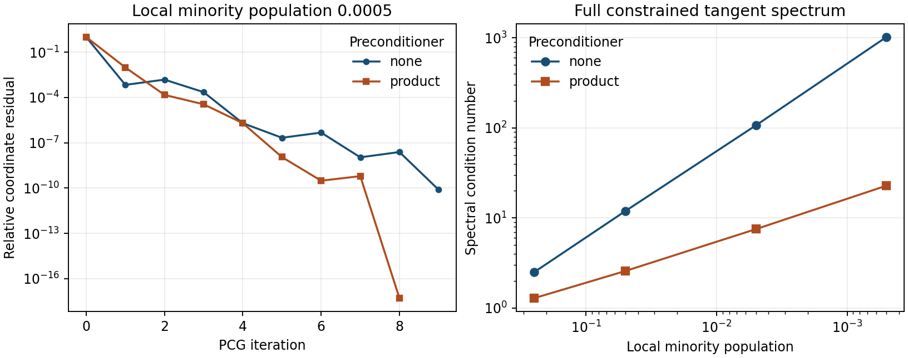

# Independent force and conditioning measurements

The three-spin Ising/loss control resolves the difference between the three velocity objectives at restricted bond. The one-site velocities from A and B differ by **0.4684** in Frobenius norm. B and C differ by **1.1331**. Each minimizes its defining error over the same 24-dimensional complex tangent. The experiment uses the existing Ising Hamiltonian and loss rates on a normalized positive root formed by summing two products of positive qubit matrices. The seed is 819, the active bond is two, the smallest root eigenvalue is 0.01267, and the commutator of the root and forcing has norm 0.5424. The root, generator, dense eigenbasis solution and all measurements are reproducible. [Driver](oracle_ablations.py) · [Raw rows and solver histories](results/oracle_20261119b/measurements.jsonl) · [Scalar table](results/oracle_20261119b/scalars.csv) · [Numerical environment and source hashes](results/oracle_20261119b/environment.json)

| Unconstrained velocity | Euclidean velocity error | Sylvester-weighted velocity error | Physical density-velocity residual |
|---|---:|---:|---:|
| A, root-force projection | **0.87536** | 0.61628 | 0.49820 |
| B, tangent Galerkin | 0.99280 | **0.58008** | 0.43120 |
| C, density least squares | 1.78631 | 0.66451 | **0.40025** |

Each column reports a norm, including the square root of the weighted quadratic form in the middle column. For the two-site space, dimension 48, the A–B and B–C differences fall to 0.01549 and 0.06466. On the independent control comprising three product spins at polarization 0.31 under onsite dephasing, the exact derivative already lies in the one-site tangent. All three methods agree to within $4\times10^{-16}$ at both tangent widths.

## Dense coordinates, coherent forcing and normalization

We assembled the dense columns by inserting a local coordinate into canonical prefix and suffix tensors directly. Applying the MPO decoder uses a separate block-automaton implementation. Diagonalization of the physical root gives the global Sylvester oracle. We solved the dense constrained systems on the nullspace of the normalization row. For the interacting one-site case, the dense metric spectrum lies in $[0.04896,1.45738]$, within the expected envelope $[2x_{\min},2x_{\max}]=[0.02535,1.52561]$. The matrix-free constrained velocity differs from the independent dense answer by $1.66\times10^{-13}$ in norm.

The production method includes $-i[H,X^2]$ inside the Galerkin right-hand side. The control checks $\mathcal S_X(-i[H,X])=-i[H,X^2]$ to $1.9\times10^{-16}$. Solving the separate coherent and dissipative Galerkin systems and adding the results changes the combined one-site velocity by $7.4\times10^{-16}$. Replacing the coherent Galerkin component with the Euclidean projection of $-i[H,X]$ changes it by **0.3995**. In the two-site space the latter difference is $1.1\times10^{-15}$ here. The coherent commutator for a nearest-neighbor Hamiltonian belongs to the two-site variation space.

For the one-site interacting control, the unconstrained velocity gives $\operatorname{Tr}(XV)=-0.007449$. The differential of norm retraction at the unit root sends $V$ to $V-X\operatorname{Re}\langle X,V\rangle$. Applying it leaves a **0.007004** difference from the normalization-constrained Galerkin solution. The constrained solve has residual $2.21\times10^{-13}$ in the normalization nullspace, normalization defect $4.2\times10^{-17}$, and **physical residual 0.43134**. This last number measures the forcing left unresolved by the velocity. It is an instantaneous derivative error. Trajectory accuracy requires scoring at a later physical time.

## Conditioning and Krylov convergence

The conditioning sweep uses three diagonal product spins with local minority population $p$. The same interacting Lindbladian drives each solve. We diagonalized the two-site metric on the normalization nullspace, using a symmetric positive square root of the projected preconditioner to obtain its preconditioned spectrum. The comparison therefore also measures eigenmodes that have little overlap with the Krylov right-hand side.

| $p$ | Condition | Product-preconditioned condition | PCG iterations | Preconditioned PCG iterations |
|---:|---:|---:|---:|---:|
| 0.25 | 2.495 | 1.285 | 9 | 7 |
| 0.05 | 11.91 | 2.576 | 9 | 7 |
| 0.005 | 106.67 | 7.518 | 10 | 7 |
| 0.0005 | 1021.90 | 22.844 | 9 | 8 |



At $p=0.0005$, building the product preconditioner took 0.56 ms and its Krylov loop took 6.67 ms, versus 4.87 ms for the unpreconditioned loop. These are single force measurements. At $p=0.005$ the preconditioned Ritz estimate from the right-hand-side Krylov space is 2.26, below the full spectral condition 7.52. The small iteration gains carry no general timing or conditioning guarantee. [Recorded force costs and residual histories](results/oracle_20261119b/measurements.jsonl)

## Working bond and changes of frame

We inspected the entire one-site action on the correlated root with coefficient/RHS caps 1, 2, 4 and unlimited. Cap 1 discards up to 0.5568 in coefficient Frobenius norm and changes the tangent matrix by 0.5077 in operator norm. Its sampled superposition and self-adjointness defects are below $10^{-15}$ because only the fixed coefficient is rounded. The production guard rejects the coefficient error. Cap 2 represents the coefficient but rejects a 0.6223 source discard. Cap 4 and unlimited pass. Their operator-norm differences from the independently assembled matrix are below $9\times10^{-16}$. The two rejected solves retain diagnostics and tracebacks. [Compression rows](results/oracle_20261119b/measurements.jsonl)

After a local $\exp(-0.001i X_1)$ gate on the same root, we evaluated the interacting generator in the new tangent frame. Encoding the previous velocity there reduces the initial relative residual from 1 to 0.001195 and the iteration count from 23 to 21. The warm and cold velocities differ by $1.75\times10^{-11}$.

## Reproduction

Run the module from the repository root with a fresh output directory. Its wall cap is 60 seconds and a watchdog samples a 512 MiB RSS limit at 50 ms intervals. Small dense arrays span at most three spins. Partial rows are flushed after each diagnostic. The final JSONL contains 38 rows. A preceding development run is archived with its own source hashes. All reported measurements use the final run. [Development snapshot](results/oracle_20261119a/environment.json) A figure can be regenerated from those rows with the second command.

```sh
VECLIB_MAXIMUM_THREADS=1 OPENBLAS_NUM_THREADS=1 MKL_NUM_THREADS=1 OMP_NUM_THREADS=1 python -m galerkin_sylvester_tdvp.oracle_ablations --out run_outputs/new_method_b_oracle
python -m galerkin_sylvester_tdvp.oracle_ablations --plot run_outputs/new_method_b_oracle
```
