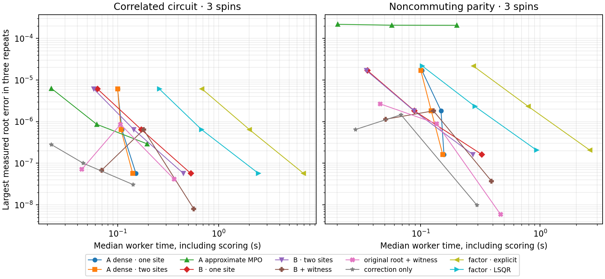

# Does a tangent-space Sylvester solve improve canonical-root dynamics?

On the four-spin interacting-loss control, two-site B reached measured global error below $10^{-5}$ in **0.288 s**. Two-site A took **0.154 s** on the same state, retraction, stage audits, step grid and bond cap. B was 1.87 times slower in this restricted comparison. It did outperform both factor implementations on the common three-spin D/E grid.

The target is the positive canonical root $X=\sqrt{\rho}$ of a physical density matrix. We compare the **measured global Frobenius error** of the stored root at the requested endpoint. The numerical state is never aligned to the reference by an auxiliary unitary. Full target roots enter the benchmark only at initialization or during independent scoring.

## Three different root approximations

While $X>0$, differentiating $X^2=\rho$ gives the force $F$ implicitly. With $G=\mathcal L(X^2)$ and the Frobenius inner product, define

$$
\mathcal S_X(V)=XV+VX,\qquad \mathcal S_X(F)=G.
$$

In an orthonormal complex frame $B$ for the active matrix-product tangent space $T$, minimizing the quadratic form $\langle V-F,\mathcal S_X(V-F)\rangle_F$ gives $B^\dagger\mathcal S_X(Bv-F)=0$ by stationarity in every coordinate. Thus Method B uses

$$
M=B^\dagger\mathcal S_X B,\qquad b=B^\dagger G,\qquad Mv=b,\qquad V=Bv.
$$

Method A first inverts the full Sylvester map, then Euclidean-projects $F$. Method C minimizes the physical density residual over the root tangent, using the design matrix $\mathcal S_X B$. In the eigenbasis of $X$, the three squared-error weights for $V_{ab}-F_{ab}$ are respectively $1$, $x_a+x_b$ and $(x_a+x_b)^2$. They coincide on the full operator space or when the restricted space reduces $\mathcal S_X$, with corresponding compatible constraints. They can differ on a tensor tangent space. The [independent oracle experiment](oracle_report.md) constructs a noncommuting example and measures all three objectives.

For a Hamiltonian term the exact coherent velocity is $-i[H,X]$, since its anticommutator with $X$ is $-i[H,X^2]$. Our generator includes the commutator in $G$ inside the solve. Linearity allows separate Galerkin solves for the coherent and dissipative right-hand sides at fixed $X$. Adding an unprojected coherent velocity outside a restricted tangent can change the equation. The tests check full-space equality and the linear, restricted split.

The existing root-force PCG applies $\mathcal S_X$ in ambient MPO space. The witness predictor uses a provisional ambient inverse followed by a tangent projection. Its endpoint corrector also accesses a separately propagated density and inverse-bound metric. Direct factor-TDVP stores $H$ with $X=HH^\dagger$, and minimizes the density residual in the real tangent of $H$ using the derivative of $(HH^\dagger)^2$. The explicit factor SVD and MPO-output LSQR solve that same factor problem. The factorization changes the admissible velocities and represents positivity structurally. Its stored factor cap and its raw root bond, up to the square of the factor bond, are reported separately.

## Gauge and dimensions

Write the local paired spin/reference label as $s=2i+k$ with $d=4$. The rank before site $j$ is $\chi_{j-1}$ and the rank after it is $\chi_j$, with both outer ranks one. A right QR sweep and left SVD sweep remove zero or numerically inactive Schmidt sectors. The default relative threshold $10^{-13}$ and the discarded allowance are recorded. A QR completion of the left isometry supplies $Q_j$ with $A_{L,j}^\dagger Q_j=0$ and $Q_j^\dagger Q_j=I$.

Each one-site coordinate block decodes to $Q_j Z_j$ between a left-isometric prefix and a right-isometric suffix. The last tensor is free. Prefix and suffix isometries preserve each block's Frobenius inner product. For two different blocks the first site where they differ contracts $Q_j^\dagger A_{L,j}=0$. Counting the complement dimension times the right bond and adding the unrestricted last site gives

$$
D_1=\sum_{j=1}^{N}d\chi_{j-1}\chi_j-\sum_{j=1}^{N-1}\chi_j^2.
$$

For a two-site block, the right coordinate index has size $d\chi_{j+1}$, and the last **pair** is free. The removed component along $A_{L,j}$ is a variation with a free next site and belongs to the next pair. Recursing to the right proves completeness for the span of adjacent-pair variations. The first-difference argument proves disjointness, including the directions that open bonds. Hence

$$
D_2=\sum_{j=1}^{N-1}d^2\chi_{j-1}\chi_{j+1}-\sum_{j=2}^{N-1}d\chi_{j-1}\chi_j.
$$

The $N=1$ implementation uses the free one-site frame. For ten sites with nine internal ranks two, the one-site count is $144-36=108$, and the two-site count is $512-128=384$. Tests build these frames, compare explicit smaller projectors with both predecessor projectors, and exercise arbitrary complex gauges, padded bonds, positive roots and a missing joint excitation. An automaton assembles all site or pair insertions in one MPO. Two-site inserts use a fixed factorization with the smaller internal dimension. A pair of prefix/suffix sweeps implements $B^\dagger$.

## Hermiticity, normalization and Krylov arithmetic

Adjointing a root MPO acts by complex conjugation and a swap of its local spin indices. It maps a fixed-rank root manifold to itself, also preserving the two-site projector span. At a Hermitian base point its tangent is invariant under this antiunitary involution. For Hermitian $G$ the unique positive-metric solution is fixed by the involution. The implementation measures adjoint leakage outside the active tangent, averages in coordinates, rechecks the physical Hermiticity defect and audits the original equation. This also exposes failures caused by finite rank thresholds.

For $\mathrm{Tr}(X^2)=1$ the constraint is $\mathrm{Tr}(XV)=0$. Let $c=B^\dagger X$ and $Q=I-cc^\dagger/(c^\dagger c)$. The constraint is real on Hermitian velocities. On complex coordinates the null space is adjoint invariant, so uniqueness and adjoint symmetry give the corresponding real solution. The dense oracle solves the saddle system directly. Production PCG stays in the null space:

$$
QMQv=Qb,\qquad Qv=v,\qquad Mv+c\lambda=b.
$$

For Hermitian positive $X$, every unit Frobenius velocity has Rayleigh quotient between $2x_{\min}$ and $2x_{\max}$. Compression only rounds the **fixed** coefficient and right-hand side before iterations. The approximated coefficient is made explicitly Hermitian if needed. Its discarded Frobenius allowance must be below the independently established positive lower bound and the rounding budget. The Weyl bound then keeps the coefficient positive. Every inner product MPO is contracted without adaptive SVD truncation. QR reduction of geometrically oversized bonds preserves the represented operator up to floating-point error. Probes and dense-oracle comparisons measure linearity, symmetry and Rayleigh quotients. Nonpositive or complex curvature raises a failure.

```text
frame = build_frame(stored_root, mode)
G = generator(product(stored_root, stored_root))
b = frame.encode(fixed_round(G))
apply(v) = frame.encode(product(Xfixed, frame.decode(v)))
         + frame.encode(product(frame.decode(v), Xfixed))
v = PCG on the normalization null space, with optional projected previous velocity
measure adjoint leakage, form the fixed Hermitian velocity in the frame
audit S_X(Bv) - G against the original stored coefficient and supplied generator
```

PCG rescales by twice the mean root eigenvalue. The optional preconditioner constructs local inverse quarter-powers of one-spin marginals, with the explicit local population floor recorded. Its action is the compression-free congruence $Y\mapsto WYW$ restricted to the same null space. Construction time, iteration counts and Ritz estimates are saved. A warm start is a previous **velocity MPO** encoded in the new frame. A small projected residual establishes stationarity. The raw tangent residual can contain the KKT multiplier, and the full density residual can contain a large orthogonal component. We save all three, measuring the latter component directly. The optional physical residual threshold can reject a solve even at coordinate convergence.

For site dimension fixed, stored bond $\chi$, velocity bond $v=O(d\chi)$, and fixed coefficient bond $k$, an exact product has virtual bond at most $kv$. Materializing its cores uses $O(Nd(kv)^2)$ entries. A sweep contracting the product with a tangent frame costs at most $O(N\,\mathrm{poly}(d)\,[\chi(kv)^2+\chi^2kv])$ for the successive contractions. Geometric exact QR, when triggered, adds up to $O(N\,\mathrm{poly}(d)\,(kv)^3)$ work. Krylov repeats the action once per iteration. The final uncompressed residual combines several MPOs and can dominate peak memory. State retraction, optional generator rounding, spectral audits, certification, scoring and rejected steps have additional costs. Neither the number of iterations nor adequate bonds have a proved uniform bound for these trajectories.

## Time integration and support

Both midpoint stages call the current-density generator. Each stage adds its velocity to the step's initial root, retracts with Hermitian Pauli-coordinate TT-SVD, then normalizes. The midpoint velocity advances the endpoint. Two-site coordinates open bonds before the state cap is imposed. Optional step doubling compares one full step to two half steps and uses their distance divided by three as a local error estimate on smooth segments. Rejections roll back state and witness. Local estimates and SVD discard are diagnostics; they alone do not bound the final CP error.

At small sizes a dense audit of the **actual numerical stage** measures the root spectrum, negative part, polar defect, support and trace. This cost belongs to production integration even though the force itself is MPO-only. At larger sizes the implementation can transport a known floor by Weyl's inequality or use a supplied stage-specific lower bound. For parity we project the stored root on the three normalized Pauli strings $I,Z^{\otimes N},X_1$, compute the fitted minimum algebraically and subtract the measured norm of the off-subspace remainder. No target coefficients or future times enter that check.

On explicitly supported singular inputs a finite CPTP seed uses the repository's current-state Kraus-factor SVD, preserving root-scale populations. A Hamiltonian Strang split surrounds commuting dissipative layers. The integrator measures unresolved kernel forcing on small inputs and audits the retracted seed. Subsequent smooth solves require a positive floor. In the square-root clock $t=t_0+u^2$ each stage multiplies its physical velocity by $2u$. Rank-deficient trajectories that stay on a proper support can require an explicit supported-space method; the full-rank solver records the refusal. The default benchmark uses no spectral regularizer to continue through it.

Optional Method B + witness fits a positive factor to the raw predicted root. The independent physical channel and inverse-bound metric enter only the endpoint procedure. Corrections/backtracking and certification are timed. Certification success concerns the returned endpoint. The raw predictor has its own comparison rows. For the large D scoring fallback we use unitality to lower-bound the true root spectrum, the actual density residual and a positive initial-root witness to bound the negative part. Conditional bounds exclude a rigorous floating-point allowance. Parity's root is analytic at every size.

## Shared physical benchmarks and provenance

The fork was fetched before branching. The research base was `b337e8b7fb86fc3cccec64e13e2ddb35cc14c4e1`. The accelerated and benchmark heads, `874388a23c5f639202adafa3247b78032efdf36c` and `facc0b7c85f2fbf816607f6365d87233a05e4054`, are eight and ten commits behind it. Current main at inspection, `46e963c6554a8ee4c42f27be489789b7b277bf9d`, had already merged this base and had the identical tree `ed692f7d76c228550f1918bcb383439f100a9c1a`. The experiment branch targets the non-main scaling branch. The comparison, physics, primary scaling and refinement grids use production source `0e0a94d77f34da437002211c4eff730c068b311a`. Their worker-level hashes agree within and across these four grids. Each additional experiment records its own source manifest. Earlier smoke, comparison-development, oracle and integrator runs are retained separately as development data.

Unmodified code supplies the MPS/MPO conventions, canonicalization, products, physical spin Hamiltonians, positive Kraus seed, A's force and projectors, Hermitian endpoint compression, D/E preparation and independent channel, witness fit, factor tangent solvers and support guards. The new directory supplies tangent coordinates, the Galerkin operator, constrained PCG, midpoint controller, audited trial corrections, a current-density MPO generator and scoring adapters. Independent tests apply each model's dense generator to an arbitrary complex density and compare with the MPO action. All costs below come from a local Apple M2, 8 GiB, macOS 26.5.1, NumPy 2.0.2 with Accelerate, SciPy 1.13.1, one requested BLAS thread. They exclude the predecessor Actions and earlier local timing datasets.

D is the controlled-phase preparation (polarization 0.12, angle 0.35, final Hadamards). E starts from the anticommuting parity ensemble with coefficients 0.6 and 0.4. Both have onsite dephasing with coherence factor $e^{-t}$. On E only the transverse coefficient decays. The repeated comparison uses $N=3,T=0.1$ for **both**, to compare at the same horizon; the larger parity study uses its historical $T=1$. Exact independently propagated density followed by diagonalization scores small D, and a closed-form global MPO scores E. The dense loss/pair reference independently exponentiates the standard Lindblad generator. The finite startup uses the current state. The rank-opening density-eigensolver reference itself can acquire root errors of order $10^{-8}$ near a kernel. Pure-pair errors are interpreted above this scale.

## Same setup and repeated cost at measured accuracy

The definitive D/E grid contains 180 completed processes: two models, ten methods, 2/6/20 physical steps, three repetitions. Root and factor storage caps were four, with work setting eight where applicable. The native witness retains its own escalation levels; D uses $(4,6,10),(6,8,12),(8,12,16)$ for factor/root/work, E uses $(4,6,8),(6,8,12)$. Native internal scoring, certificate I/O and any factor updates are included. The primary measure is wall time from the initialized worker entering the case until independent endpoint scoring and diagnostic aggregation finish. Full process wall time including interpreter startup, and peak RSS, are also retained. Timing is for these implementations, including module initialization and the diagnostic history writes each actually performed.

At **two endpoints** the following are measured global CP errors and median worker times in seconds. All ran to the final time. No witness data enter the raw B or dense A force. Approximate A and witness variants use additional preparation-derived operators.

| Method | D error | D seconds | E error | E seconds |
|---|---:|---:|---:|---:|
| A, dense two-site, historical polar retraction | 6.06e-6 | 0.100 | 1.69e-5 | 0.100 |
| A, approximate two-site MPO predictor | 6.28e-6 | 0.0221 | 2.18e-4 | 0.0202 |
| B, two-site, raw | 6.06e-6 | 0.0581 | 1.69e-5 | 0.0352 |
| B plus positive witness | 6.81e-8 | 0.0695 | 1.14e-6 | 0.0508 |
| Native root plus positive witness | 7.13e-8 | 0.0442 | 2.67e-6 | 0.0458 |
| Native correction only | 2.83e-7 | 0.0220 | 6.47e-7 | 0.0285 |
| Factor, explicit real SVD | 6.10e-6 | 0.685 | 2.16e-5 | 0.277 |
| Factor, accelerated MPO LSQR | 6.10e-6 | 0.259 | 2.16e-5 | 0.103 |

The two factor backends stored factor/root bonds 4/16 on D and 2/4 on E. Raw B's root bonds were 4 and 2. Factor evolution includes its dense support audits and, for partial progress preservation, reconstructs the Hamiltonian/jump MPOs at each endpoint. These three-spin controls allow a full operator tangent for D at cap four; E has a closed analytic algebra. They test the engines and costs on common trajectories. The restricted interacting experiments below test accuracy under genuine tangent limitations.

For **matched accuracy**, a configuration qualifies only if all three independent processes complete and each measured root error meets the target. The cheapest observed median is chosen separately per method and target. The matrix below gives $10^{-5}$ and $10^{-7}$ worker times in seconds; an em dash means the grid had no qualifying configuration. The downloadable tables include the $10^{-3}$ frontier, all misses, settings, worst repeated error, RSS and process times. [All 60 configurations](figures/configurations.csv) · [All measured-accuracy frontiers](figures/matched_accuracy.csv) · [Raw 180-run table](results/comparison_20261119/measurements.csv)

| Method | D at 1e-5 | D at 1e-7 | E at 1e-5 | E at 1e-7 |
|---|---:|---:|---:|---:|
| A, dense one-site | 0.0999 | 0.152 | 0.148 | — |
| A, dense two-site | 0.100 | 0.141 | 0.123 | — |
| A, approximate MPO two-site | 0.0221 | — | — | — |
| B, raw one-site | 0.0633 | 0.531 | 0.0886 | — |
| B, raw two-site | 0.0581 | 0.448 | 0.0879 | — |
| B plus witness | 0.0695 | 0.0695 | 0.0508 | 0.392 |
| Native root plus witness | 0.0442 | 0.0442 | 0.0458 | 0.467 |
| Native correction only | 0.0220 | 0.142 | 0.0285 | 0.296 |
| Factor, explicit | 0.685 | 6.93 | 0.796 | — |
| Factor, MPO LSQR | 0.259 | 2.48 | 0.285 | — |



Setup changes the ranking for short runs. On two-step D/E, dense two-site A spent 94.1/94.6 ms in setup and 5.0/5.0 ms integrating. Raw two-site B spent 7.1/6.8 ms in setup and 48.8/26.7 ms integrating. Endpoint scoring was approximately 0.6–0.8 ms each. B can win short one-shot jobs against the historical dense A driver despite its slower integration loop. At D error $10^{-7}$, both need 20 steps; dense A's lower per-step cost dominates. The corrected variants have separate information budgets. No raw-force speed conclusion follows from an endpoint corrected using independently propagated density or a witness bound. The [oracle conditioning plot and true residual histories](oracle_report.md) show what the inner iteration does and where its cost goes.

## Generic interacting chains, solvable controls and rank opening

The 60 single-trajectory physics runs used four intervals. Interacting loss uses the original nearest-neighbor Ising $J_{zz}=0.7$ and transverse/longitudinal fields 0.43/0.19, with site-dependent lowering rates. Pair dephasing uses each nearest-neighbor $ZZ$ jump and the original rates. The pure initial state is $|+\rangle^{\otimes N}$. The smooth variant mixes its density with 20% maximally mixed state. Small-system independent reference densities and positive roots are scored at $T=0.03$. With root cap four, the measured final errors on the interacting loss model were:

| Spins | B one-site, mixed | B two-site, mixed | A two-site, mixed | B two-site, pure | A two-site, pure |
|---:|---:|---:|---:|---:|---:|
| 2 | 4.31e-5 | 1.09e-6 | 1.09e-6 | 9.61e-5 | 9.61e-5 |
| 3 | 8.14e-5 | 3.18e-6 | 3.18e-6 | 1.57e-4 | 1.57e-4 |
| 4 | 4.06e-3 | 2.37e-4 | 2.37e-4 | iteration failure | 2.08e-4 |
| 5 | 7.39e-3 | 4.18e-4 | 4.18e-4 | iteration failure | 2.51e-4 |

B one-site also exhausted its iteration budget after a finite seed on four- and five-spin pure loss. On pure pair dephasing both B modes rejected the seed at all four sizes. Pair flips preserve global $X^{\otimes N}$ parity on the initial state. The exact channel cannot reach full ambient rank. This is an expected limitation of the full-rank production variant. The historical dense A force can continue on its supported denominators and reached these endpoints. On mixed pair dephasing B two-site errors ranged from $3.24\times10^{-6}$ to $4.44\times10^{-4}$. All eight full-rank/supported controls for mixed product dephasing, the stationary commuting limit, coherent evolution and pure cluster startup completed for both B modes. At three spins, two-site B's errors in that order were $4.05\times10^{-6}$, $4.15\times10^{-16}$, $2.30\times10^{-6}$, and $2.25\times10^{-3}$. Completion of the cluster trajectory would fail a $10^{-3}$ accuracy target. [All statuses, errors and costs](results/physics_20261119/measurements.csv)

Time and bond refinement separate two error sources. On four-spin mixed loss, doubling the step count from four to eight at cap four barely changed two-site B's error (0.0002369 to 0.0002368). At cap sixteen the same refinement reduced it from $6.76\times10^{-6}$ to $1.68\times10^{-6}$. At cap two the error remained about 0.0401 for two, four and eight steps. An independent three-spin restricted Ising-loss case had inner residual below $7\times10^{-11}$ and root error 0.0673. The square-root clock control retained a root eigenvalue $10^{-9}$ at density population $10^{-18}$. Constrained and post-normalized trajectories, warm starts, step doubling, work caps and preconditioner setup were measured separately. [Four-spin refinement rows](results/refine_20261119/measurements.csv) · [Independent integration ablations](integration_ablation.md)

## Restricted comparison with identical retraction and stage checks

The paired four-spin experiment isolates the choice of velocity objective. A constructs the current dense Sylvester force, applies the repository's one- or two-site Euclidean projector and removes the radial component. A and B both use the new Hermitian TT-SVD retraction, normalization, stage positivity checks, physical input, endpoint scoring and timing harness. The separate historical polar A remains a contextual control. We used full-rank interacting loss, $T=0.03$, work bond 32, and three repetitions at each of three prespecified (state cap, step count) settings: (2,2), (4,4), (8,4). Factor LSQR ran at the first two settings only.

| Measured CP target | Cheapest observed two-site A | Cheapest observed two-site B | B/A time |
|---|---:|---:|---:|
| 1e-3 | 0.1527 s, cap 4 | 0.2878 s, cap 8 | 1.88 |
| 1e-5 | 0.1539 s, cap 8 | 0.2878 s, cap 8 | 1.87 |

Every selected repetition met its target. At the tighter target both use four steps. The two-site frame initially has 96 of 256 complex coordinates. At caps four and eight it reaches all 256 by the second stage. At cap two it stays restricted throughout. The one-site frame stays restricted at every tested cap. The successful two-site trajectories therefore compare the cost of evolving through bond growth; they do not show that the restricted A and B objectives agree. One-site A and B each missed both accuracy targets on this grid; their best measured errors were approximately 0.00372 and 0.00406. Factor LSQR failed its midpoint stationarity guard in all six attempts. No failed time enters a successful frontier. The modest difference between cap-four and cap-eight median times makes the precise winning cap at the looser target sensitive to timing variation. These are observed minima, with full configurations and process RSS available. [51 workers](results/restricted_20261119/measurements.csv) · [Matched targets](results/restricted_20261119/matched_accuracy.csv)

## Correlated-chain and parity scaling

The first two-step, cap-four D attempt at eight spins exceeded the RHS rounding allowance at work 16. At 16, 32 and 64 spins the Frobenius movement bound did not establish a positive spectrum for a required stage. These runs produced no global endpoint score. In a separate prespecified follow-up we increased the D work bond to 64 and audited movement relative to the known positive initial root with grouped MPO operator bounds. Any SVD discard contributes to the bound. When necessary, the audit applied the known inverse half-power of that initial root in a congruence; this is model-specific extra initialization information. The force continued to apply the general current-density generator. The auditor and its assumptions are described in the [follow-up report](scaling_followup.md).

| Family and horizon | Spins | Steps | Measured global error | Conditional global upper bound | Outcome |
|---|---:|---:|---:|---:|---|
| D, 0.1 | 8 | 2 | 1.124e-5 | 2.204e-5 | Completed |
| D, 0.1 | 16 | 2 | unavailable | 8.714e-5 | Completed |
| D, 0.1 | 32, 64 | 2 | unavailable | unavailable | Stage positivity unresolved |
| E, 1 | 8, 16, 32, 64 | 2 | 6.918e-3 at each size | — | Completed |
| E, 1 | 8, 16, 32, 64 | 8 | 3.135e-4 at each size | — | Completed |

The D32 audit established positivity at the first midpoint but could not establish it at the endpoint. D64 stopped at its first midpoint. Both ran within the wall and memory guards. There is no observed evidence here that either stored candidate had a negative eigenvalue. For E, two to eight steps improved the independently measured root error by a factor of 22.1 at 64 spins. Its tiny density Frobenius error at that size ($1.31\times10^{-13}$) would seriously overstate root accuracy if used as a substitute. The analytic parity oracle is accessed by independent scoring; the optional numerical-stage positivity audit only knows the Pauli subspace and fits the numerical coefficients. These are single size-extension runs. [First scaling grid](results/scaling_20261119/measurements.csv) · [Follow-up raw data](results/scaling_followup_20261119/measurements.csv)

## Interpretation

**Established by tests.** The matrix-free action and velocity agree with independently assembled dense Galerkin equations on positive small systems. The one-site and overlapping two-site frames have the predicted active dimensions. The normalization nullspace solve, measured Hermitian tangent, explicit failure statuses, certified finite startup control and independent global scores distinguish inner convergence from dynamical accuracy.

**Conditional on model and representation.** On the three-spin D/E grids, raw B is cheaper than either factor solver at the measured targets they both reach. Its ranking against conventional root evolution changes with setup cost, tolerance and model. Positive-witness correction can be worth more than a change of force objective when a cheap independent channel and metric are available. The long parity trajectory exploits low bond and a checkable operator algebra. The D16 global error bound depends on a valid positive initial anchor, the specified unital channel, the operator-norm allowance and ordinary floating-point contractions.

**Open.** The measurements do not establish an end-to-end speed advantage for B over the available root solvers across models. Generic restricted trajectories can be dominated by state truncation, stiffness near support opening, or the cost of proving that a stored root remains positive. Efficient invariant-support continuation for pure pair dephasing, generic large-chain positivity certificates, tighter stopping criteria near small eigenvalues and total cost at finer measured accuracy remain open. Fixed-bond contraction counts alone do not establish how work, memory or achievable accuracy scale with system size.

## Validation and reproduction

The automated suite passed 30 tests for frames, dense and MPO equations, integrator behavior, physical models, statistical selection, resource failures, branch bounds and historical file hashes. Another 74 predecessor algorithm, accounting and publication regressions passed. The four-spin matched adapter also has a direct two-spin full-tangent oracle check. Reported failures in deliberately bounded experiments remain in the raw data. Numerical success per worker means the specified algorithm finished; accuracy is separately decided by an independent measured error or a labeled conditional bound. [Test logs](results/validation_20261119) · [All data cohorts](results/README.md) · [Installation and exact commands](README.md)
