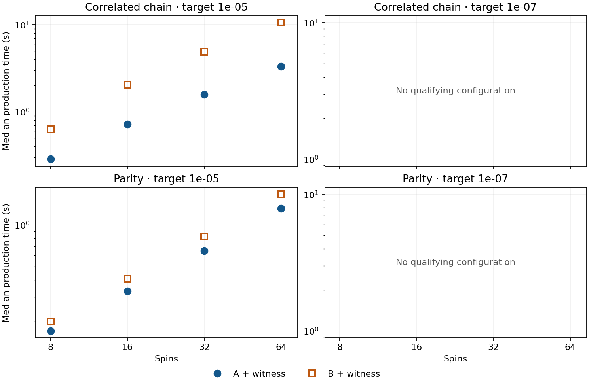

# Two-site root evolution with a positive endpoint witness

The correlated-chain comparison uses the measured global canonical-root error at eight spins and the conditional global witness bound at 16, 32 and 64 spins. The parity family has an independent analytic global root at every size. Method A uses the repository’s approximate ambient MPO predictor. Method B solves the tangent Galerkin equation. Each predictor feeds the same positive-witness endpoint procedure.

## Repeated cost at matched accuracy

A setting qualifies when every planned confirmation repeat finishes at the requested time and passes the target. The selected setting minimizes median production time, including setup, prediction, witness correction/certification and checkpoint I/O. Independent scoring time, complete worker time, RSS and selected configuration IDs are in the frontier table. A B/A value above one means B took longer. A dash means the grid did not establish that entry. [Accuracy frontiers](matched_accuracy.csv) · [Common step and witness settings](same_settings.csv)

### Global target 1e-05

| Family | Spins | Evidence | A error or bound | A seconds | B error or bound | B seconds | B/A |
|---|---:|---|---:|---:|---:|---:|---:|
| D | 8 | measured | 5.56e-07 | 0.286 | 5.54e-07 | 0.629 | 2.2 |
| D | 16 | conditional bound | 1.89e-06 | 0.719 | 1.89e-06 | 2.05 | 2.85 |
| D | 32 | conditional bound | 2.87e-06 | 1.58 | 2.84e-06 | 4.87 | 3.09 |
| D | 64 | conditional bound | 4.41e-06 | 3.3 | 4.19e-06 | 10.6 | 3.2 |
| E | 8 | measured | 1.21e-06 | 0.171 | 2.36e-06 | 0.199 | 1.17 |
| E | 16 | measured | 1.21e-06 | 0.331 | 2.36e-06 | 0.408 | 1.23 |
| E | 32 | measured | 1.21e-06 | 0.653 | 2.36e-06 | 0.823 | 1.26 |
| E | 64 | measured | 1.21e-06 | 1.32 | 2.36e-06 | 1.67 | 1.27 |

### Global target 1e-07

| Family | Spins | Evidence | A error or bound | A seconds | B error or bound | B seconds | B/A |
|---|---:|---|---:|---:|---:|---:|---:|
| D | 8 | measured | — | — | — | — | — |
| D | 16 | conditional bound | — | — | — | — | — |
| D | 32 | conditional bound | — | — | — | — | — |
| D | 64 | conditional bound | — | — | — | — | — |
| E | 8 | measured | — | — | — | — | — |
| E | 16 | measured | — | — | — | — | — |
| E | 32 | measured | — | — | — | — | — |
| E | 64 | measured | — | — | — | — | — |

The frontier CSV also covers the looser $10^{-3}$ target. The error and bound columns give the largest observed value among all repeats of the selected configuration. The figure shows each method only at sizes with qualifying confirmation repeats. An unresolved upper bound leaves the target unconfirmed. It does not measure the true root error on the larger correlated chains.

## Coverage and failed endpoints

| Phase | Family | Spins | Method | Completed / planned workers | Status counts |
|---|---|---:|---|---:|---|
| confirm | D | 8 | A | 3 / 3 | completed (3) |
| confirm | D | 8 | B | 3 / 3 | completed (3) |
| confirm | D | 16 | A | 3 / 3 | completed (3) |
| confirm | D | 16 | B | 3 / 3 | completed (3) |
| confirm | D | 32 | A | 3 / 3 | completed (3) |
| confirm | D | 32 | B | 3 / 3 | completed (3) |
| confirm | D | 64 | A | 3 / 3 | completed (3) |
| confirm | D | 64 | B | 3 / 3 | completed (3) |
| confirm | E | 8 | A | 3 / 3 | completed (3) |
| confirm | E | 8 | B | 3 / 3 | completed (3) |
| confirm | E | 16 | A | 3 / 3 | completed (3) |
| confirm | E | 16 | B | 3 / 3 | completed (3) |
| confirm | E | 32 | A | 3 / 3 | completed (3) |
| confirm | E | 32 | B | 3 / 3 | completed (3) |
| confirm | E | 64 | A | 3 / 3 | completed (3) |
| confirm | E | 64 | B | 3 / 3 | completed (3) |
| screen | D | 8 | A | 1 / 1 | completed (1) |
| screen | D | 8 | B | 1 / 1 | completed (1) |
| screen | D | 16 | A | 1 / 1 | completed (1) |
| screen | D | 16 | B | 1 / 1 | completed (1) |
| screen | D | 32 | A | 1 / 1 | completed (1) |
| screen | D | 32 | B | 1 / 1 | completed (1) |
| screen | D | 64 | A | 1 / 1 | completed (1) |
| screen | D | 64 | B | 1 / 1 | completed (1) |
| screen | E | 8 | A | 1 / 1 | completed (1) |
| screen | E | 8 | B | 1 / 1 | completed (1) |
| screen | E | 16 | A | 1 / 1 | completed (1) |
| screen | E | 16 | B | 1 / 1 | completed (1) |
| screen | E | 32 | A | 1 / 1 | completed (1) |
| screen | E | 32 | B | 1 / 1 | completed (1) |
| screen | E | 64 | A | 1 / 1 | completed (1) |
| screen | E | 64 | B | 1 / 1 | completed (1) |

The common-setting table pairs the endpoint grid, state cap, witness levels, passes and tolerance. Each predictor’s work cap appears separately. The screening rows in the frontier CSV give single-run observations. Confirmation uses its own independently timed workers. Each configuration retains its statuses, completed endpoint count and reached times. The raw records hold the trial-level diagnostics. [All configurations](configurations.csv) · [Raw worker measurements](../measurements.json) · [Run environment](../environment.json)
