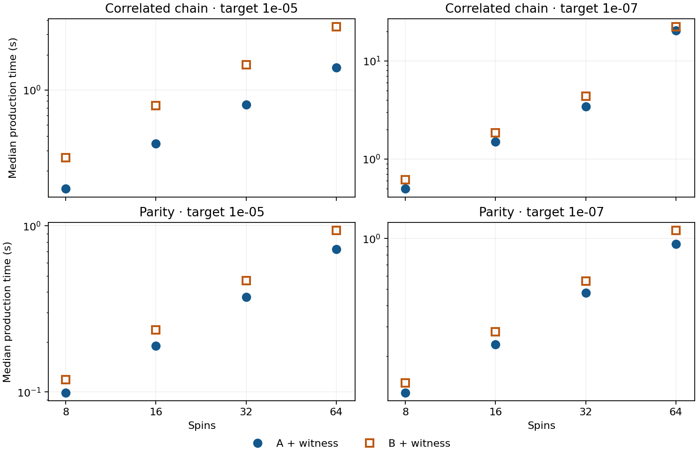

# Positive-witness comparison at 8, 16, 32 and 64 spins

Both methods reached the global canonical-purification targets of $10^{-5}$ and $10^{-7}$ on both families at all four sizes. **A had the lower median production time in all 16 matched comparisons** on the grid that tested one and two intervals. Both methods selected one midpoint interval at every winning setting. Each run computed a physical predictor and applied the positive witness at the requested endpoint.

| Family | Spins | A seconds at $10^{-5}$ | B seconds | B/A | A seconds at $10^{-7}$ | B seconds | B/A |
|---|---:|---:|---:|---:|---:|---:|---:|
| Correlated | 8 | 0.14 | 0.261 | 1.86 | 0.497 | 0.617 | 1.24 |
| Correlated | 16 | 0.344 | 0.73 | 2.12 | 1.5 | 1.86 | 1.24 |
| Correlated | 32 | 0.745 | 1.65 | 2.21 | 3.45 | 4.37 | 1.27 |
| Correlated | 64 | 1.55 | 3.49 | 2.25 | 20.3 | 22.3 | 1.09 |
| Parity | 8 | 0.0992 | 0.118 | 1.19 | 0.122 | 0.139 | 1.14 |
| Parity | 16 | 0.19 | 0.236 | 1.24 | 0.236 | 0.28 | 1.19 |
| Parity | 32 | 0.373 | 0.469 | 1.26 | 0.475 | 0.559 | 1.18 |
| Parity | 64 | 0.723 | 0.937 | 1.3 | 0.926 | 1.12 | 1.21 |

The errors are independently measured at every parity size and at eight spins on the correlated chain. Larger correlated chains use conditional global upper bounds. At 64 spins and $10^{-7}$, both correlated runs achieved a bound of $1.29\times10^{-8}$. Each accepted the predictor as its starting point for ten witness corrections. Median witness times were 19.41 s for A and 19.48 s for B. The predictors took 0.84 s and 2.68 s, respectively. Including independent scoring gives 21.39 s for A and 23.28 s for B. At the same target, the 64-spin parity errors were $2.46\times10^{-8}$ for A and $2.23\times10^{-8}$ for B. [All achieved scores and repeated times](results/witness_pair_streamed_20261119/analysis/report.md) · [Timing ranges, memory and configurations](results/witness_pair_streamed_20261119/analysis/matched_accuracy.csv)

## Comparison with a corrected intermediate state

Both algorithms take two midpoint intervals and pass the same witness test at the intermediate time and the final time. The bond and correction budgets match at every endpoint. All 64 workers in this fixed-grid study completed, including three fresh confirmation repeats per method and size. The table gives median production seconds.

| Spins | Correlated A | Correlated B | B/A | Parity A | Parity B | B/A |
|---:|---:|---:|---:|---:|---:|---:|
| 8 | 0.286 | 0.629 | 2.2 | 0.171 | 0.199 | 1.17 |
| 16 | 0.719 | 2.05 | 2.85 | 0.331 | 0.408 | 1.23 |
| 32 | 1.58 | 4.87 | 3.09 | 0.653 | 0.823 | 1.26 |
| 64 | 3.3 | 10.6 | 3.2 | 1.32 | 1.67 | 1.27 |

At 64 correlated spins A and B each spent 1.54 s on the witness. The predictors took 1.67 s for A and 8.94 s for B. Peak RSS medians were 115 and 294 MiB. At 64 parity spins the measured global errors were $1.21\times10^{-6}$ for A and $2.36\times10^{-6}$ for B. [Fixed-grid scores, times and failures](results/witness_pair_two_step_20261119/analysis/report.md) · [Timing and memory breakdown](results/witness_pair_two_step_20261119/analysis/matched_accuracy.csv)

The tighter completed checkpoints also constrain the actual errors of the 64-spin correlated trajectories. If a separately computed root has witness radius $e$ and its distance to an evaluated root is $d$, the triangle inequality bounds the error between $d-e$ and $d+e$. Intersecting with each run’s own bound and allowing for numerical roundoff gives **$[2.05,2.08]\times10^{-6}$ for A** and **$[1.94,1.98]\times10^{-6}$ for B** on the two-interval grid. B’s final error was slightly smaller on this comparison and its runtime was 3.20 times larger. These intervals inherit the witness assumptions. The independent scores for every available eight-spin correlated and parity control fell inside their intervals. [Reference checkpoints and error brackets](results/witness_pair_brackets_20261119/report.md)



## What the accuracy target measures

For the stored canonical root $X$ and physical density $\rho(T)$, the global error is $\|X-\sqrt{\rho(T)}\|_F$. This equals the Euclidean distance of the vectorized purifications in the same canonical gauge. Both methods must reach the same physical time and accuracy threshold. The score applies to the entire chain. A tighter threshold can require a larger witness factor or more correction steps.

| Physical family | Final time | Global accuracy evidence |
|---|---:|---|
| D, controlled-phase correlated preparation, local polarization 0.12 and angle 0.35 | 0.1 | At 8 spins the channel-evolved density is independently diagonalized to construct its positive root. At 16, 32 and 64 spins the score is a conditional upper bound on the same Frobenius error. |
| E, anticommuting parity ensemble with longitudinal and transverse coefficients 0.6 and 0.4 | 1 | The transverse coefficient evolves to $0.4e^{-T}$. A closed-form MPO gives the global positive root at every size, including 64 spins. |

Both families undergo onsite dephasing. The endpoint witness uses the exact channel-evolved **density** in MPO form. It fits a factor to the predicted root, chooses between the prediction and the previous root using the smaller bound, then applies the same factor corrections and backtracking until the acceptance target is reached or the budget is exhausted. The bound includes the distance to a positive factor product, the density residual weighted with the model's inverse-density bound, residual truncation, and an allowance for Hermitian symmetrization. The assumptions include the supplied channel and initial density and the numerical accuracy of MPO contractions. The implementation uses ordinary floating-point arithmetic. This access to a tractable physical density is part of the cost and scope of both algorithms. [Witness implementation](../scalable_cp_witness/code/scalable_cp_witness.py)

## Predictors and resource accounting

Method A uses the scalable ambient MPO Sylvester approximation, consisting of a preconditioned proposal and a residual correction, followed by the existing two-site Euclidean tangent projection. Method B solves the constrained two-site Galerkin Sylvester equation using the current numerical root at each midpoint stage. Both start each new interval from the preceding witness-accepted root. Both retract to predictor bond 4 for D and 2 for E. The common witness can raise the stored endpoint bond. The factor/root/work levels are 4/6/10, 6/8/12 and 8/12/16 on D, and 4/6/8 and 6/8/12 on E. The separate predictor work limits are 10 and 64 for A and B on D, and 8 and 16 on E.

Method B requires a positive spectral lower bound for the actual numerical root at each solve. On D, a lower bound from displacement is tried first. When it is inconclusive, undoing the initial preparation circuit and whitening by the known initial root reduces the question to bounding a transformed MPO. The identity Pauli coefficient minus a majorant of the nonidentity coefficients gives a sufficient lower bound. On E, the corresponding test uses the parity algebra and charges the norm of any component outside it. A failed lower bound leaves the endpoint unconfirmed. [Stage audit](witness_stage.py) · [Paired worker](witness_pair_worker.py)

Production time includes setup, positive-stage checks, the predictors, endpoint density propagation, factor fitting, corrections, certificates, and checkpoint writes. Separate columns give independent scoring time, total worker time including scoring, process wall time including startup, and peak resident memory. Times are for serial, isolated workers on an Apple M2 with a single requested BLAS thread. The per-worker limits are 180 seconds and 1536 MiB peak RSS. Candidate settings are screened once. Qualifying settings are then run in three fresh processes. The tables report median production time and the worst endpoint score across the three repeats. [Hardware and libraries](results/validation_20261119/hardware.json)

## Follow-up to the large-chain failures

On the primary two-interval grid, B reached the first 64-spin correlated checkpoint with a bound of $1.78\times10^{-6}$ at $T=0.05$. At the next midpoint the Pauli test was inconclusive. At $10^{-7}$, the 16-spin run crossed the RSS limit and the 32- and 64-spin runs encountered the solver's core-allocation guard. At 64 spins A's best final trial on the primary two-interval grid had a bound of $1.51\times10^{-7}$ and was rejected. Its weighted density residual alone was $1.35\times10^{-7}$.

The follow-up reruns **both** methods in fresh workers. It tests one and two midpoint intervals, and gives both methods the additional witness levels 10/14/20 and 12/16/24 for the tight correlated target. The witness residual bond stays at 24. In B, a streamed contraction applies the same two-site Galerkin operator one local product core at a time. A shared, untruncated QR sweep evaluates the physical and outside-tangent residual norms. If the Pauli positivity test is inconclusive, a second test bounds the transformed numerical root using positive local block marginals and an operator-norm bound on the other virtual paths. Both tests use the known initial preparation. Independent small-chain tests compare the streamed solve with the original and dense constrained solves and check the block bound against dense eigenvalues. [Streamed solver](witness_streaming.py) · [Block bound](witness_block_stage.py)

The original implementation completed 108 of 119 workers. At the $10^{-5}$ target, B took 9.0, 25.2 and 31.9 times A's production time on the 8-, 16- and 32-spin correlated chains. On parity it took 1.47–1.96 times A's time across the four sizes. The follow-up's 64-spin two-interval screen cleared the previously unresolved midpoint and finished with upper bounds of $4.41\times 10^{-6}$ for A and $4.19\times 10^{-6}$ for B. Thus a 64-spin result is available even when an intermediate corrected endpoint is required. [Original repeated comparisons and failures](results/witness_pair_20261119/analysis/report.md) · [Follow-up same-setting table](results/witness_pair_streamed_20261119/analysis/same_settings.csv)

The one/two-interval follow-up completed 158 of 160 workers. At $10^{-7}$, the 32- and 64-spin two-interval B solvers reached the first corrected checkpoint but the next high-bond product exceeded the local allocation cap. The one-interval results at this tolerance establish final-time accuracy only. Multi-interval B at this tighter target remains unresolved on those two chains under these budgets. All 343 worker records, including the 13 failed attempts across the three studies, are archived. The 130 Galerkin, witness, and predecessor regression tests passed. [Test log](results/witness_pair_streamed_20261119/regression_tests.txt) · [Data index](results/README.md)

## Reproduction

Run from the repository root with the [pinned numerical environment](README.md). Use fresh output directories. Each command writes its candidate grid, numerical source hashes, per-worker events, last accepted tensors, and all final statuses.

```sh
python3 -m galerkin_sylvester_tdvp.witness_pair_scaling --out run_outputs/witness-pair --timeout 180 --memory-mib 1536
python3 -m galerkin_sylvester_tdvp.witness_pair_supplement --variant streamed-block --families D E --sizes 64 32 16 8 --steps 1 2 --tolerances 1e-5 1e-7 --extended-witness --timeout 180 --memory-mib 1536 --out run_outputs/witness-streamed
python3 -m galerkin_sylvester_tdvp.witness_pair_supplement --variant streamed-block --families D E --sizes 8 16 32 64 --steps 2 --tolerances 1e-5 --extended-witness --timeout 180 --memory-mib 1536 --out run_outputs/witness-two-step
python3 -m galerkin_sylvester_tdvp.witness_pair_analysis run_outputs/witness-pair
python3 -m galerkin_sylvester_tdvp.witness_pair_analysis run_outputs/witness-streamed
python3 -m galerkin_sylvester_tdvp.witness_pair_analysis run_outputs/witness-two-step
python3 -m galerkin_sylvester_tdvp.witness_pair_brackets run_outputs/witness-pair run_outputs/witness-streamed run_outputs/witness-two-step --out run_outputs/witness-brackets
python3 -m galerkin_sylvester_tdvp.witness_pair_archive pack run_outputs/witness-pair
python3 -m galerkin_sylvester_tdvp.witness_pair_archive pack run_outputs/witness-streamed
python3 -m galerkin_sylvester_tdvp.witness_pair_archive pack run_outputs/witness-two-step
```
