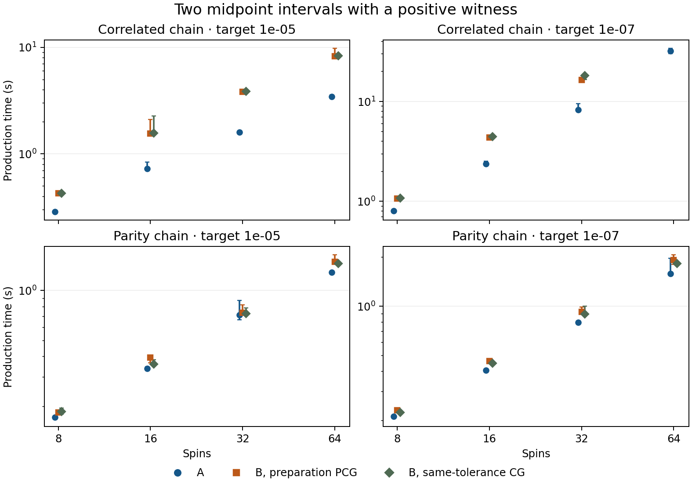

# Does A’s preconditioner make the tangent Sylvester solve competitive?

Both methods reached both global CP targets at 8, 16, 32 and 64 spins. The fastest confirmed setting for both methods used one midpoint interval in all 16 size/family/target comparisons. A had the lower median in 15. At 64 correlated spins and $10^{-7}$ the initial three repeats gave a small median advantage for B with overlapping timing ranges. **A was faster in all six additional balanced pairs** at that setting. The full experiment shows that iteration savings alone did not give B a repeatable end-to-end speed advantage on these two families.

## Fastest confirmed settings

Times are median production seconds. Each cell compares complete trajectories with the same endpoint target. The selected B tolerance is its inner relative Galerkin residual tolerance.

| Family | Spins | A at $10^{-5}$ | B at $10^{-5}$ | B inner tol. | A at $10^{-7}$ | B at $10^{-7}$ | B inner tol. |
|---|---:|---:|---:|---:|---:|---:|---:|
| Correlated | 8 | 0.14 | 0.178 | 0.1 | 0.501 | 0.545 | 0.000316 |
| Correlated | 16 | 0.349 | 0.527 | 0.1 | 1.51 | 1.67 | 0.1 |
| Correlated | 32 | 0.748 | 1.24 | 0.00316 | 3.47 | 3.94 | 0.1 |
| Correlated | 64 | 1.56 | 2.63 | 0.1 | 22.9 | 22.2 | 0.1 |
| Parity | 8 | 0.0996 | 0.108 | 1e-09 | 0.127 | 0.132 | 0.1 |
| Parity | 16 | 0.191 | 0.217 | 1e-09 | 0.242 | 0.26 | 0.01 |
| Parity | 32 | 0.376 | 0.425 | 1e-05 | 0.465 | 0.53 | 0.01 |
| Parity | 64 | 0.728 | 0.84 | 0.1 | 0.935 | 1.06 | 0.01 |

The 533-worker main study included 251 screens and 282 fresh confirmations. Ten screens exceeded the high-bond residual rank cap; the other 523 workers completed and met their configured endpoint target. The matched unpreconditioned B control used the exact same chosen tolerance. Preconditioning reduced the iteration count on 22 of the 31 confirmed matched grids and tied it on the other nine. It gave a lower median production time on 13 of those 31 grids, counting both step counts. Several differences were small compared with the range of three repeats. [Fastest settings and global scores](results/witness_preconditioned_20261119/analysis/frontier.csv) · [Every grid, repeat range, and control](results/witness_preconditioned_20261119/analysis/matched_accuracy.csv)

## Balanced check of the closest result

At 64 correlated spins and $10^{-7}$, the initial three-repeat ranges were 19.93–25.05 s for A and 21.50–23.79 s for B. B used relative tolerance 0.1. For a separate check we froze those exact two settings and ran six adjacent pairs on the same machine, three in each order. A finished first in **six of six** pairs. Its median was **20.20 s** versus **21.58 s** for B. The median within-pair B/A ratio was **1.066**, with individual ratios from 1.045 to 1.181. The median paired time difference was 1.34 s. Every pair met the endpoint target, with conditional global bounds of $1.29\times10^{-8}$ for both methods. The follow-up was selected after seeing the close initial medians. [Per-pair costs and accuracy](results/witness_preconditioned_pairs_20261119/pairs.csv) · [Summary](results/witness_preconditioned_pairs_20261119/summary.json)

## Two intervals with an intermediate witness correction

The first accepted state is fed back into the predictor. Each row uses the same intermediate and final time, endpoint certificate threshold and witness budget. Iterations are the totals for all four solver stages. The controls in the CG column use the tolerance selected for PCG.

### Global threshold 1e-05

| Family | Spins | A (s) | B, PCG (s) | B, CG (s) | Inner tol. | PCG / CG iterations |
|---|---:|---:|---:|---:|---:|---:|
| Correlated | 8 | 0.287 | 0.427 | 0.426 | 0.1 | 4 / 8 |
| Correlated | 16 | 0.725 | 1.54 | 1.56 | 0.01 | 8 / 12 |
| Correlated | 32 | 1.6 | 3.82 | 3.84 | 1e-05 | 14 / 26 |
| Correlated | 64 | 3.45 | 8.27 | 8.32 | 0.01 | 8 / 12 |
| Parity | 8 | 0.171 | 0.183 | 0.185 | 1e-05 | 8 / 8 |
| Parity | 16 | 0.339 | 0.395 | 0.36 | 0.1 | 4 / 6 |
| Parity | 32 | 0.713 | 0.734 | 0.725 | 0.1 | 4 / 6 |
| Parity | 64 | 1.29 | 1.49 | 1.46 | 0.1 | 4 / 6 |

### Global threshold 1e-07

| Family | Spins | A (s) | B, PCG (s) | B, CG (s) | Inner tol. | PCG / CG iterations |
|---|---:|---:|---:|---:|---:|---:|
| Correlated | 8 | 0.8 | 1.06 | 1.07 | 0.000316 | 8 / 20 |
| Correlated | 16 | 2.36 | 4.37 | 4.43 | 0.1 | 4 / 8 |
| Correlated | 32 | 8.28 | 16.4 | 18.1 | 0.000316 | 12 / 20 |
| Correlated | 64† | 30.6 | 46.1 | 46.1 | 0.000316 | 12 / 20 |
| Parity | 8 | 0.211 | 0.23 | 0.223 | 1e-09 | 8 / 8 |
| Parity | 16 | 0.404 | 0.46 | 0.446 | 1e-09 | 8 / 8 |
| Parity | 32 | 0.793 | 0.92 | 0.893 | 1e-07 | 8 / 8 |
| Parity | 64 | 1.57 | 1.91 | 1.82 | 0.1 | 4 / 6 |

† The $10^{-7}$ two-interval correlated result at 64 spins is from the separately repeated high-bond diagnostic comparison described below. The figure and main CSV cover the original 533-worker study. [64-spin fixed-grid comparison](results/witness_preconditioned_d64_20261119/analysis/matched_accuracy.csv)

For the 64-spin correlated chain at $10^{-5}$, the strict screens at $10^{-9}$ used 44 CG and 23 PCG iterations. At the selected $10^{-2}$, the repeated trajectories used 12 CG and 8 PCG iterations. The PCG trajectory took 8.27 s, including 0.152 s for Krylov iterations, with 0.074 s of that time applying the preconditioner. The post-solve residual and structural checks took 4.32 s and the endpoint witness took 1.55 s. A took 3.45 s. The older B implementation took 10.56 s in the earlier study. The present same-backend controls put the cost of tuning and the preconditioner in context because the projected contractions also changed. [Stage timing](results/witness_preconditioned_20261119/analysis/stage_solves.csv) · [Strict and tuned screens](results/witness_preconditioned_20261119/analysis/strict_controls.csv) · [Historical comparison](results/witness_preconditioned_20261119/analysis/historical_comparison.csv)

At this same 64-spin two-interval endpoint, a separate tighter witnessed root brackets the actual global errors at $[2.05,2.08]\times10^{-6}$ for A and $[1.92,1.96]\times10^{-6}$ for tuned B. These brackets are conditional on the witness assumptions. At the tighter one-interval target, the two endpoint bounds were both $1.29\times10^{-8}$. [Achieved error brackets](results/witness_preconditioned_20261119/analysis/brackets.csv)



## What changed in B

At the current positive root $X$, B solves the constrained Galerkin equation for $V$ with $\mathcal S_X(V)=XV+VX$. Let $U$ be the orthonormal two-site tangent frame and $Q$ the projector removing its radial direction. A's scalable ambient predictor uses $W=\rho(0)^{-1/4}$, available as a compact MPO from the initial preparation, for a trial inverse and one residual correction. For the new B predictor, the same witness engine supplies **the very same anchor MPO**. The preconditioner acting on a tangent residual $r$ is

$$
P r = \tfrac{1}{2} Q U^\dagger \bigl[ W\,(U Qr)\, W \bigr].
$$

A positive scalar compensates the solver's rescaling of the Galerkin matrix. For an admissible nonzero $r$, the quadratic form before rescaling is $\|W^{1/2}(Ur)W^{1/2}\|_F^2/2>0$. The code uses two tensor-network sweeps and a fixed anchor. It performs no adaptive truncation of the preconditioned search vectors. CG starts at zero in every stage. The exact unpreconditioned original-equation residual in tangent coordinates is checked after the solve, including the Hermiticity and normalization steps. [Preparation action](witness_anchor_preconditioner.py) · [Solver and diagnostics](witness_precond_solver.py)

For both B variants, direct contractions apply the two terms of the Sylvester matrix in tangent coordinates. They give the same unrounded projected products as the previous backend. Physical and outside-tangent residuals use lossless streamed QR when the panels fit. With larger panels the code can instead bound those diagnostic norms using rounded products with explicit absolute Frobenius allowances. The projected stationarity check and the endpoint witness are separate from those diagnostic bounds. This change in implementation is shared by the new preconditioned and unpreconditioned controls. Comparisons to older timings include its effect.

## Accuracy and timing protocol

The study uses the same correlated dephasing chain ($T=0.1$) and parity dephasing chain ($T=1$) as the preceding comparison. Both predictors call the same warm factor fit, physical density propagation, positivity witness and correction procedure. Each must pass the global certificate at **every accepted checkpoint**. The score at the final time is $\|X-\sqrt{\rho(T)}\|_F$. Independent diagonalization gives the correlated score at 8 spins, and the analytic parity MPO gives it at all four sizes. For the 16-, 32- and 64-spin correlated chains the evidence is a conditional global upper bound, evaluated in floating point. [Physical models and certificate assumptions](witness_pair_report.md)

For each endpoint tolerance $\epsilon\in\{10^{-5},10^{-7}\}$ and each one- or two-interval grid, preconditioned B was screened at the five relative Galerkin tolerances $0.1$, $0.01$, $\sqrt{\epsilon}$, $\epsilon$ and $10^{-9}$. These relative force residuals and the absolute global root errors have different meanings. The selection rule uses the **fastest production time among runs passing the actual endpoint checks**. The unpreconditioned control uses the same numerical backend, witness settings and chosen relative tolerance. Separate strict screens compare both solvers at $10^{-9}$. A uses its original fixed-cost ambient predictor. Both algorithms retract to the same predictor bond cap and have the same endpoint factor/root/work levels. The internal predictor work caps follow the previous implementation, 10 for A and 64 for B on the correlated chain, and 8 and 16 on parity.

Reported production times are medians of three fresh confirmation processes, with reversed ordering on the middle pass. They include setup, prediction, stage checks, witness operations, checkpointing and diagnostic writes. Independent final scoring and interpreter startup are available in separate timing fields. Workers run serially with one requested BLAS thread, a 180-second process limit and a 1536 MiB peak-RSS guard. Stage iteration counts are sums over all solves in a trajectory. Preconditioner application time is part of Krylov time.

## High-bond residual measurements

On the 64-spin correlated chain at $10^{-7}$, the first corrected root has bond 12. The two-interval B screens completed that first interval. When advancing from the corrected state, the product approximation used to measure the full residual requested rank 256 at one cut, above its diagnostic cap of 192. All five solve tolerances hit this guard. At 32 spins two tolerances passed the corresponding two-interval test. These outcomes concern an auxiliary measurement of a local force. The one-interval, full-horizon endpoint scores remain available separately.

The additional 64-spin experiment repeats A and both B controls with a different way to bound the high-bond diagnostic products. It computes suffix fourth moments of the stored root to tighten the truncation allowance. Its product rank ceiling is 128. If a sharper interval would require a larger rank, it retains the full allowance for discarded directions and records the resulting physical-residual and outside-tangent intervals. Each worker stores the largest realized half-width relative to the generator norm and flags missed diagnostic widths. The unrounded projected-equation acceptance, both positive-witness certificates, and the process limits are the same as in the main study. [Diagnostic bound](witness_suffix_audit.py) · [Separate driver](witness_preconditioned_suffix_run.py)

All 17 workers in this separate comparison completed. Median times were 30.63 s for A, 46.09 s for preparation-PCG B and 46.06 s for same-tolerance CG B. With an inner tolerance of $3.16\times10^{-4}$ the trajectories took 12 PCG or 20 CG iterations. Both A and B finished with a global upper bound of $1.29\times10^{-8}$. On one of the four PCG stages, the relative half-width of the auxiliary physical residual interval was $1.60\times10^{-5}$ of the generator norm, above the requested $10^{-6}$. The corresponding maximum for the unpreconditioned control was $3.37\times10^{-5}$. All four stages passed the separately evaluated, unrounded projected stationarity test. [Stage diagnostics and residual intervals](results/witness_preconditioned_d64_20261119/analysis/stage_solves.csv) · [Raw measurements](results/witness_preconditioned_d64_20261119/measurements.json)

Across the main, high-bond and order-balanced studies, 552 of 562 workers completed, including every confirmation. Ten primary screens stopped at the diagnostic rank cap. All 147 regression tests passed. [Test log](results/witness_preconditioned_20261119/regression_tests.txt) · [Failed settings and last accepted times](results/witness_preconditioned_20261119/analysis/failures.csv)

## Reproduction

From the repository root with the [pinned numerical environment](README.md), run

```sh
python3 -m galerkin_sylvester_tdvp.witness_preconditioned_run --one-step-all --out run_outputs/witness-preconditioned
python3 -m galerkin_sylvester_tdvp.witness_preconditioned_analysis run_outputs/witness-preconditioned --prior galerkin_sylvester_tdvp/results/witness_pair_two_step_20261119 --prior galerkin_sylvester_tdvp/results/witness_pair_streamed_20261119 --reference-cohort galerkin_sylvester_tdvp/results/witness_pair_streamed_20261119
python3 -m galerkin_sylvester_tdvp.witness_pair_archive pack run_outputs/witness-preconditioned
python3 -m galerkin_sylvester_tdvp.witness_pair_archive verify run_outputs/witness-preconditioned
python3 -m galerkin_sylvester_tdvp.witness_preconditioned_suffix_run --out run_outputs/witness-preconditioned-d64 --audit-rank-cap 128 --diagnostic-relative-width 1e-6 --allow-wider-diagnostic --timeout 180 --memory-mib 1536
python3 -m galerkin_sylvester_tdvp.witness_preconditioned_analysis run_outputs/witness-preconditioned-d64
python3 -m galerkin_sylvester_tdvp.witness_pair_archive pack run_outputs/witness-preconditioned-d64
python3 -m galerkin_sylvester_tdvp.witness_preconditioned_paired_repeats run_outputs/witness-preconditioned --out run_outputs/witness-preconditioned-pairs
python3 -m galerkin_sylvester_tdvp.witness_pair_archive pack run_outputs/witness-preconditioned-pairs
```
