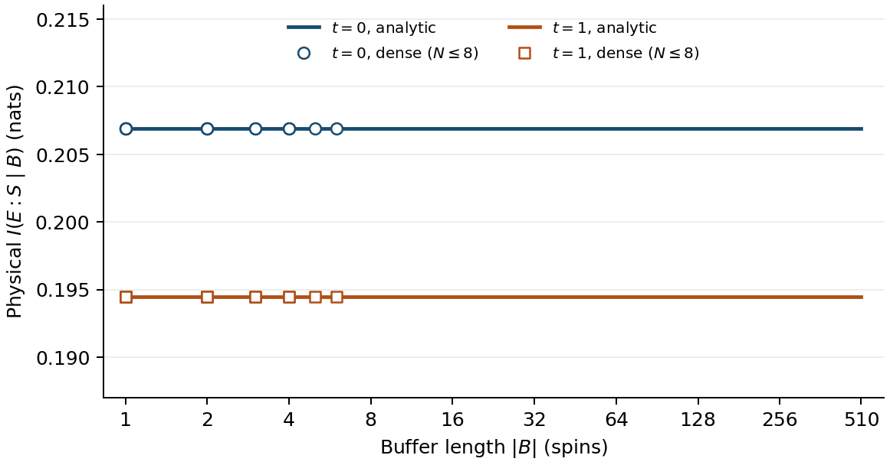

# Exact controls for parity dephasing

## Spectrum, root and operator entanglement

Write $`D=2^N`$, $`P=Z_1\cdots Z_N`$, $`Q=X_1`$ and $`b=b_0e^{-t}`$. The finite dephasing channel on spin $`j`$ is $`(1-q)Y+qZ_jYZ_j`$, with $`q=(1-e^{-h})/2`$. Every $`Z_j`$ commutes with $`P`$. Only $`Z_1`$ anticommutes with $`Q`$, so one uniform sweep and the spin-1 channel alone yield the same exact density. The two protocols perform different numbers of operations.

Let $`M=pP+bQ`$. Anticommutation gives $`M^2=r^2 I`$ with $`r=(p^2+b^2)^{1/2}`$. For $`r>0`$, the spectral projectors are $`(I\pm M/r)/2`$. Tracelessness of $`M`$ gives equal multiplicities $`D/2`$. Thus $`\rho=(I+M)/D`$ has eigenvalues $`(1\pm r)/D`$, and spectral calculus gives the positive canonical root

```math
S=D^{-1/2}(aI+c pP+c bQ),\qquad
a=\frac{\sqrt{1+r}+\sqrt{1-r}}{2},\qquad c=\frac{1}{2a}.
```

These coefficients extend to $`r=0`$ continuously. The spectral condition number is $`\kappa(\rho)=(1+r)/(1-r)`$, independent of $`N`$. At the primary parameters it falls from $`6.171293`$ to $`4.232605`$ by $`t=1`$. Absolute eigenvalues still decrease exponentially in $`N`$. The identities $`2ac=1`$ and $`a^2+c^2r^2=1`$ check $`S^2=\rho`$ and $`\|S\|_F=1`$.

Group each physical and reference spin into a doubled site. On any subset, use Pauli strings divided by the square root of its Hilbert-space dimension as orthonormal operator vectors. For a proper $`W`$ containing spin 1, write $`E=W^c`$. The two terms $`I,Q`$ share $`I_E`$, while $`P`$ has exterior $`P_E\perp I_E`$. This gives a two-branch Schmidt form with left vectors

```math
u_W=\frac{a I_W+cb Q_W}{\sqrt{1-w}},\qquad
v_W=\mathrm{sgn}(p)P_W,\qquad w=(cp)^2 .
```

Here and in the Schmidt expressions $`I_W,Q_W,P_W`$ are normalized vectors. The two coefficients are $`\sqrt{1-w},\sqrt w`$. Every contiguous cut separates spin 1 from a nonempty exterior on one side. The canonical root therefore has exact spatial bond two for $`p\ne0`$, with operator entanglement entropy $`h(w)`$ for binary entropy $`h`$. At $`p=0`$ the sole occupied branch has bond one. This low entanglement makes this parity trajectory favorable for a global tensor representation.

## Conditional mutual information and the channel bound

Take a partition of the whole chain into nonempty $`A,B,C`$ with spin 1 in $`A`$. Write $`f(x)=h((1+x)/2)`$ with $`h(s)=-s\log s-(1-s)\log(1-s)`$, using nats. Tracing out any spin kills $`P`$. A proper marginal containing spin 1 has eigenvalues $`(1\pm b)/2^{|R|}`$ with equal multiplicities, so its entropy is $`(|R|-1)\log2+f(b)`$. A marginal omitting spin 1 is maximally mixed. The full-chain entropy is $`(N-1)\log2+f(r)`$. Consequently

```math
I(A:C\mid B)=S_{AB}+S_{BC}-S_B-S_{ABC}=f(b)-f(r).
```

This applies also to the active window $`W=\{1\}\cup B`$ with $`B`$ empty, through the usual mutual-information formula. For $`p\ne0`$ the expression is positive and independent of buffer length whenever $`E`$ remains nonempty. It persists along the entire trajectory, tending to $`\log2-f(|p|)`$ as $`t\to\infty`$. The thermodynamic family therefore has infinite Markov length in this full-chain test. Arbitrarily wide buffers with the same positive CMI violate a uniform exponential-in-width bound with finite length. Tracing out an additional spectator before forming the tripartition removes $`P`$ and changes the test. Setting $`p=0`$ gives a product physical state and zero CMI at every width. Setting $`b_0=0`$ retains positive CMI for $`p\ne0`$ throughout an exactly stationary trajectory.

The algorithm note bounds the best unitary CP error on the doubled active window by $`\sqrt{I_{\rm before}(E:1\mid B)-I_{\rm after}(E:1\mid B)}`$. An unaffected spin loses zero CMI and admits the identity lift. For the active spin the complete $`0\to1`$ update loses $`0.01245647`$ nats, leaving $`0.19445335`$ nats. Its bound is $`0.11160854`$ and the actual optimum is $`0.00913726`$. Width-independent CMI thus coexists with a quantified, channel-dependent information loss. A lower bound on the error requires a separate argument. [Original algorithm, Section 2](../two_ways_to_evolve_canonical_purification.md#2-apply-a-finite-local-lift-on-doubled-sites)

| Spin-1 interval | CMI lost (nats) | Square-root bound | Optimal proper-window error |
|---|---:|---:|---:|
| $`0\to0.02`$ | 0.000632311 | 0.0251458 | 0.000458839 |
| $`0.02\to0.1`$ | 0.00223077 | 0.0472311 | 0.00162266 |
| $`0.1\to0.3`$ | 0.00399888 | 0.0632367 | 0.00292499 |
| $`0.3\to0.6`$ | 0.00342129 | 0.0584918 | 0.00252048 |
| $`0.6\to1`$ | 0.00217321 | 0.0466178 | 0.00161031 |

The step table also covers all intervals of the uniform 1, 2, 5, 10, 20, 50 and 100-step grids. Each row records both the CMI loss and the optimal error on that interval assuming exact input. The global endpoint obstruction for repeated updates follows from the support union. [All 193 interval checks](results/oracle_01/information_steps.csv)



The lines extend to a 510-spin buffer in the $`N=512`$ family. Open symbols use eigenvalues of independent dense physical marginals for $`N=3,4,6,8`$. Multiple chain sizes coincide at a given width. [Dense CMI checks](results/oracle_01/dense_cmi.csv) · [Width grid](results/oracle_01/buffer_cmi.csv)

## Exact proper-window unitary minimum

A unitary on the doubled $`W`$ preserves the exterior CP density $`(1-w)|I_E\rangle\langle I_E|+w|P_E\rangle\langle P_E|`$. In the overlap of the two endpoint roots the two exterior vectors are orthogonal. Cauchy–Schwarz bounds its real part by $`\sqrt{(1-w_0)(1-w_1)}+\sqrt{w_0w_1}`$. Both terms can attain equality at once. In the left $`I_W,Q_W`$ plane rotate through $`\theta_1-\theta_0`$ with $`\theta_i=\mathrm{atan2}(c_i b_i,a_i)`$. Extend this rotation by the identity on the orthogonal complement, which includes $`P_W`$. Then

```math
\epsilon_U=
\sqrt{\big(\sqrt{w_1}-\sqrt{w_0}\big)^2+
       \big(\sqrt{1-w_1}-\sqrt{1-w_0}\big)^2}.
```

At $`t=0,1`$ the weights are $`0.1063314266443093`$ and $`0.1007641268161698`$. The optimum is $`0.009137257950008726`$ for any nonempty exterior. For a whole-chain window, the two unit Frobenius vectors can be mapped into each other by a global Householder reflection, giving zero error. This global construction uses the target root. The numerical oracle also forms the dense polar factor of $`T L^\dagger`$ for endpoint amplitudes reshaped with the doubled $`W`$ sites as rows. It limits this matrix to 65,536 entries. The explicit action checks the larger width cases without the dense gate.

A product of unitaries on a fixed $`W`$ is a unitary on $`W`$. If multiple windows have a proper union containing spin 1, the same argument applies to that union. For a fixed $`W`$, successive rotations above compose to the endpoint rotation, so the lower bound is attainable at any time subdivision. For a sweep whose support union reaches the whole chain, the exterior-invariance argument no longer supplies this bound. Proper fitting regions erase all information about $`p`$ from their physical marginals. Native completion and its action on the globally populated parity branch are separately measurable. [Dense Procrustes and explicit action](results/oracle_01/dense_validation.csv)

## Direct half-Petz amplitude and composition

For a proper $`W`$ containing spin 1 let $`R_i=I+b_iQ`$ and $`\mathcal D_h`$ be finite dephasing on that spin. Scalars from $`r_W=2^{-|W|}R_0`$ and $`s_W=2^{-|W|}R_1`$ cancel, leaving the full amplitude

```math
Y_{\rm HP}=R_1^{-1/2}\mathcal D_h(R_0^{1/2}S_0).
```

The four-string algebra $`(I,P,Q,QP)`$ closes because $`P,Q`$ anticommute. Factor out $`2^{-N/2}`$ from all amplitudes. Let $`R_0^{1/2}=uI+vQ`$ and $`R_1^{-1/2}=UI+VQ`$. For either power $`\gamma`$, the identity and $`Q`$ coefficients are $`[(1+b)^\gamma\pm(1-b)^\gamma]/2`$. Put $`x=c_0p`$, $`y=c_0b_0`$, and write $`R_0^{1/2}S_0`$ in coefficient order $`(A,B,C,D')=(ua_0+vy,ux,uy+va_0,vx)`$. Dephasing multiplies the last two components by $`d=e^{-h}`$. Left multiplication by $`R_1^{-1/2}`$ yields

```math
(UA+VdC,\quad UB+VdD',\quad UdC+VA,\quad UdD'+VB).
```

The numerical oracle realizes the same algebra using $`P=Z`$, $`Q=X`$ in dimension two, with trace divided by two in norm squares. In that representation conjugation by $`Z`$ implements the physical spin-1 conjugation on these four coefficients. A real coefficient on $`QP`$ contributes an anti-Hermitian component since $`(QP)^\dagger=-QP`$. At $`t=1`$ the $`QP`$ coefficient is $`0.000901910443`$, so the skew norm is twice this value.

| Native half-Petz quantity at $`t=1`$ | Proper-window result |
|---|---:|
| Raw global root error | 0.004268780588 |
| Amplitude norm | 0.997763476485 |
| Hermiticity defect | 0.001803820885 |
| Global error after diagnostic normalization | 0.003640066538 |

For successive updates on a fixed window, full rank permits exact cancellation of the intermediate left factors $`r_1^{1/2}r_1^{-1/2}=I`$. Composing the physical channels inside the resulting expression gives

```math
\mathcal F_{21}\mathcal F_{10}(Y)
=r_2^{-1/2}\mathcal D_{21}\mathcal D_{10}(r_0^{1/2}Y)
=\mathcal F_{20}(Y).
```

This identity holds for arbitrary input amplitudes when the physical marginals and channel composition are consistent. It predicts a subdivision-independent endpoint for the uncompressed half-Petz construction. Finite bond truncation or numerical loss of support can alter it. For whole-chain $`W`$ and exact incoming root, the channel acts on $`\rho_0`$ and the outgoing amplitude is $`\rho_1^{-1/2}\rho_1=\sqrt{\rho_1}`$. For an exact parity path, nominally inactive $`Z_j`$ commute with the physical cache, the canonical roots, and the four-string half-Petz amplitudes. The exact inactive half-Petz update is the identity on these amplitudes. The plateau measured on proper windows concerns this specific map. [Independent dense Kraus checks](results/oracle_01/dense_validation.csv) · [Original half-Petz construction](../half_petz_evolution/report.md)

## Independent numerical checks and scope

Direct dense diagonalization at $`N=2,3,4,6,8`$ checks the MPO roots to $`7.44\times10^{-16}`$ and their Schmidt spectra to $`1.34\times10^{-15}`$. Across 21 window cases the largest error discrepancy of the explicit optimal action is $`5.27\times10^{-16}`$. The 16 independently formed dense polar gates agree with the analytic optimum to $`1.78\times10^{-15}`$. Across all 21 cases the independent dense half-Petz raw-error discrepancy is at most $`2.23\times10^{-16}`$, and splitting the interval at $`0.37`$ changes the resulting amplitude by at most $`4.00\times10^{-16}`$. All 26 dense entropy checks agree within $`2.56\times10^{-15}`$. [Prespecified design](results/oracle_01/design.json) · [Validation summary](results/oracle_01/summary.json)

At $`N=8,t=1`$, reversing $`p`$ leaves every proper physical marginal exactly unchanged. Removing any one spin annihilates $`P`$, which also proves equality on all smaller subsets. The global canonical-root change is $`2|cp|=0.6348673146923531`$. Thus an exact local physical fit can coexist with a large global CP discrepancy. Production scoring forms the difference of the actual stored amplitude and the analytic root before evaluating its norm. For a general amplitude the physical state is $`YY^\dagger`$. The scoring code reports both the absolute and relative density residual, scaling the two operands by $`2^{N/2}`$ during contraction to retain accuracy on long chains. [Measured marginal counterexample](results/oracle_01/locality_counterexample.json) · [Scoring code](oracles.py)

The product and stationary controls distinguish three properties of the model. The product path at $`p=0`$ evolves while its exact proper-window floors vanish. The stationary parity state at $`b_0=0`$, $`p\ne0`$ has positive CMI at every buffer but loses zero information per update and admits identity throughout. The primary noncommuting path evolves with positive CMI at every time. An ordinary locally reversible comparison is provided by cluster dephasing in the numerical benchmark. The primary example has a region of fixed positive CMI throughout its parameter sweep in time, with constant exact root bond. It supplies no evidence for a finite-time critical crossing or generic interacting-state costs. [Control and horizon oracles](results/oracle_01/analytic_floors.csv) · [Locally reversible predecessor](../half_petz_evolution/report.md)
