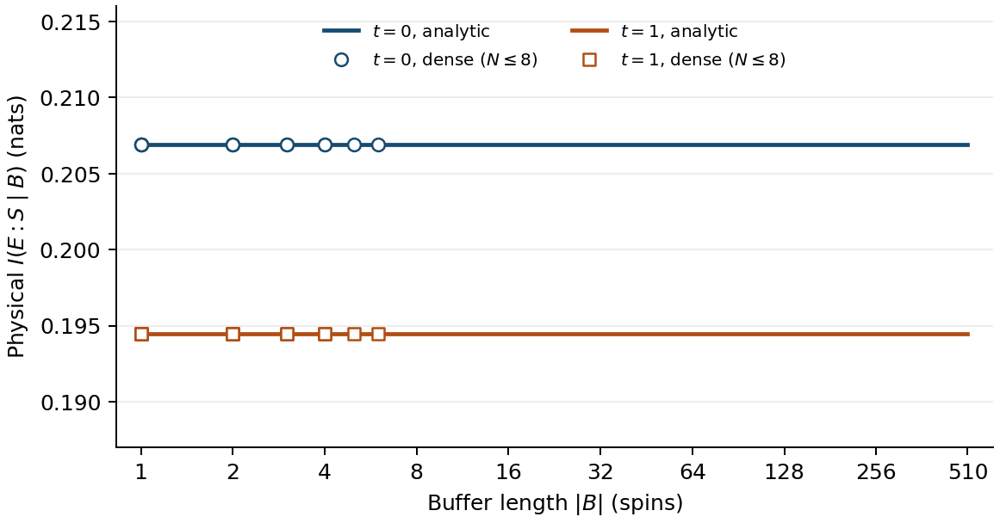
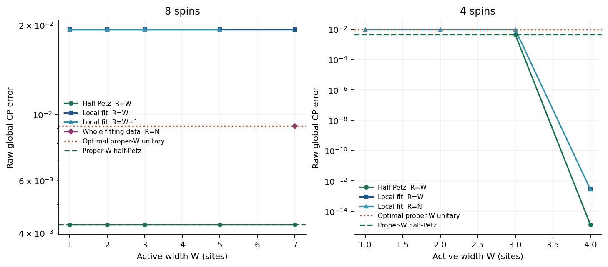
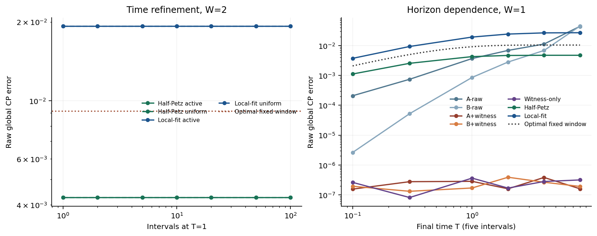
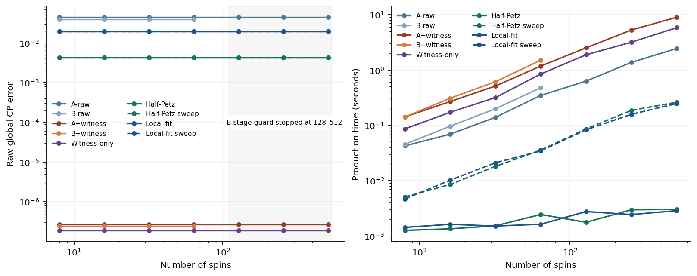
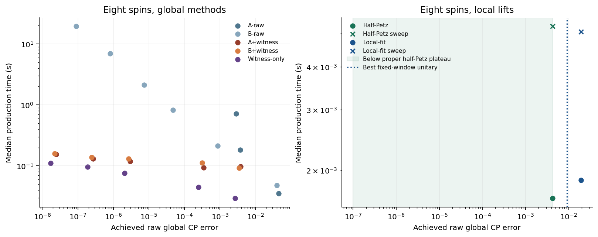
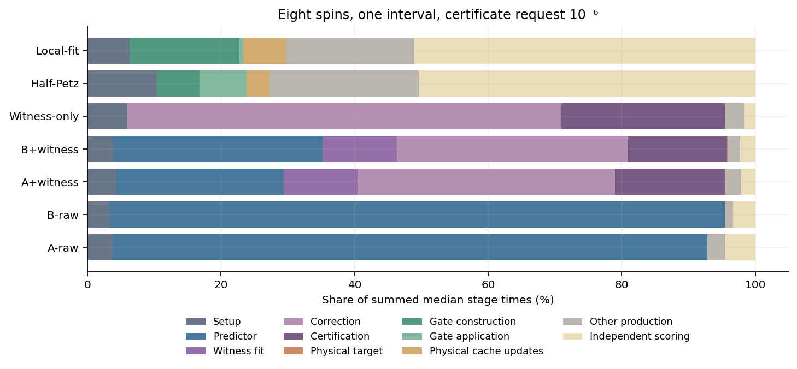

# Global canonical-root TDVP and finite local lifts at infinite Markov length

**A bond-two global root tracked the noncommuting parity trajectory through 512 spins.** At the five historical endpoints through $`T=1`$, Method A with a positive witness reached a raw global canonical-purification (CP) error of $`2.317\times10^{-7}`$ with a conditional bound of $`5.805\times10^{-7}`$. Correction from the previous factor alone reached $`2.365\times10^{-7}`$ on the same grid. The direct half-Petz lift reached 0.004269 and the practical unitary fit reached 0.01928. Each algorithm started with the same physical state. The global witness had independently propagated full-chain density and inverse-bound data, whereas the local lifts propagated proper physical marginals. [Historical-grid measurements](results/historical_01/measurements.jsonl) · [Independent native replay and QR check](results/global_native_512)

## State, information and representability

Take $`N\ge 2`$ open-chain qubits, $`P=Z_1\cdots Z_N`$, $`Q=X_1`$, $`b=b_0e^{-t}`$ and $`r=\sqrt{p^2+b^2}<1`$. The state is $`\rho=2^{-N}(I+pP+bQ)`$. The onsite generator is one half the sum of conjugation by each $`Z_j`$ minus the identity channel. Only site 1 changes the exact state. Its finite channel has phase-flip probability $`(1-e^{-h})/2`$ in time $`h`$. All primary measurements use $`p=0.6`$ and $`b_0=0.4`$.

The two eigenvalues of $`\rho`$ are $`2^{-N}(1\pm r)`$, each of multiplicity $`2^{N-1}`$, since $`P`$ and $`Q`$ anticommute and square to the identity. Interpolating the square root between them gives

```math
S=\sqrt{\rho}=2^{-N/2}(a I+c p P+c b Q),\qquad
a=\frac{\sqrt{1+r}+\sqrt{1-r}}{2},\qquad c=\frac{1}{2a}.
```

This expression is continuous at $`r=0`$. Squaring gives $`\rho`$ and $`\lVert S\rVert_F^2=\mathrm{Tr}\rho=1`$. In the interleaved physical/reference site order, the $`I`$ and $`Q`$ strings share their entire exterior tail. Across every spatial cut the two orthogonal branches have Schmidt coefficients $`\sqrt{1-w}`$ and $`\sqrt w`$ with $`w=p^2c^2`$. The operator bond is at most two. The physical condition number $`(1+r)/(1-r)`$ is independent of $`N`$ even though its smallest eigenvalue decreases exponentially.

For any complete physical tripartition with site 1 in $`A`$ and $`A,B,C`$ nonempty, tracing out any spin kills the parity string. The proper marginal on $`AB`$ has only the $`X_1`$ bias, whereas $`BC`$ and $`B`$ are maximally mixed. Substitution of the global and marginal spectra into the entropy combination gives, with binary entropy $`h_2`$ in nats,

```math
I(A:C\mid B)=h_2((1+b)/2)-h_2((1+r)/2).
```

The initial and final CMI are 0.206910 and 0.194453 nats for *every* admissible buffer. Taking unbounded buffer widths rules out a size-independent exponential decay bound for this family. The whole update loses only 0.0124565 nats. The channel–unitary correspondence bounds the best local unitary error by the square root of that loss, 0.11161. On an inactive channel the loss is zero. The analytic optimum below makes this upper bound quite loose. The loss in each step of the historical and uniform time grids is recorded separately. [Information-loss data](results/oracle_01/information_steps.csv) · [Original algorithm note](../two_ways_to_evolve_canonical_purification.md) · [Li, Firanko and Hsieh, Corollary 13](https://arxiv.org/html/2605.00088v2#S5.SS2)



## What a proper local window can attain

**Any unitary on the doubled active window.** Let $`W`$ contain site 1 and leave at least one exterior spin. In normalized operator-vector notation the exterior Schmidt vectors are $`I_E`$ and $`P_E`$. Their weights change under exact dephasing. A unitary on $`W`$ preserves both exterior weights. Cauchy–Schwarz bounds the overlap by the sum of the two products of Schmidt coefficients. A rotation of the left $`I_W,Q_W`$ combination to its target direction, fixing $`P_W`$, attains equality. The optimum is therefore

```math
\epsilon_U^2=(\sqrt{w_1}-\sqrt{w_0})^2+
(\sqrt{1-w_1}-\sqrt{1-w_0})^2 .
```

Here $`w_0=0.10633142664`$, $`w_1=0.10076412682`$ and $`\epsilon_U=0.00913725795`$. Composing any number of unitaries whose union stays inside a proper window leaves this endpoint lower bound intact. On the whole chain, a unitary can align the two normalized vectors exactly. A sweep whose windows cover the chain has to be evaluated separately.

**Half-Petz.** Every proper active marginal is $`2^{-|W|}(I+bQ_W)`$ and is independent of $`p`$. Insert its positive roots into the native forward lift. With exact input the output is

```math
Y=(I+b(T)Q)^{-1/2}\,\mathcal D_T\!\left[(I+b_0Q)^{1/2}S(0)\right].
```

For composition on a fixed window, the left square root at the start of the next map cancels the inverse square root left by its predecessor, for any incoming amplitude. The physical dephasing maps form a semigroup. This proves telescoping with the correct marginals and without truncation. A faithful two-dimensional Pauli representation including $`QP`$ evaluates the expression using half the ordinary trace. The native raw error is **0.00426878059**, with norm 0.99776347649 and Hermiticity defect 0.00180382089. Rescaling this output to unit norm gives the diagnostic error 0.00364006654. All production and frontier scores use the stored output. For a whole-chain input $`S=\sqrt\rho`$, the matrix product of the two initial square roots is $`\rho`$ and the result is exactly the next positive root. This plateau concerns the specified map.

**Practical local fit.** A proper fitting region $`R`$ contains the product marginal even when $`R`$ strictly contains $`W`$. The input column space of the local fit has rank one. The native polar fit rotates its populated local direction and extends the rotation by identity off the joint span. It rotates the $`I,Q`$ combination by the angle inferred from the product marginal. The globally occupied branch requires a different angle when $`p\ne0`$. At eight spins a local fitting residual of $`2.63\times10^{-13}`$ coexisted with a global error of **0.01928021378**, about 2.11 times the attainable optimum. For $`W=1,2,3,5,7`$ the native error agreed while $`R`$ remained proper. At $`W=7,R=8`$ it reached 0.00913726. At four spins with $`W=R=4`$ the fit and half-Petz errors were $`2.84\times10^{-13}`$ and $`1.36\times10^{-15}`$. These full-data controls are excluded from the production frontier. The local solver uses a compact gate and applies its identity completion implicitly. [Angular derivation and SVD conventions](local_methods.md) · [Width measurements](results/width_01/measurements.jsonl)



There is also a strict diagnostic counterexample. At eight spins and $`T=1`$, switching the sign of $`p`$ leaves every proper physical marginal identical and changes the global CP by 0.6348673. A small fitting residual or accurate cached marginal cannot certify the global root. Across the dense validation grid $`N=2,3,4,6,8`$, 16 independent polar solves checked attainment and five oversized dense gates used a matrix-free attaining rotation. The primary half-Petz formula agreed with direct dense Kraus application within $`2.3\times10^{-16}`$ in raw error. [Dense validation and guarded controls](results/oracle_01) · [Proofs and four Pauli coefficients](math.md)

## Algorithms and scoring

| Method | Update, information and checks |
|---|---|
| A-raw | Native preparation-based approximate Sylvester inverse, one residual correction, two-site Frobenius tangent projection, midpoint step and Hermitian normalized retraction. |
| B-raw | Existing two-site Galerkin Sylvester solve at the actual initial and midpoint roots, normalization constraint, prepared MPO-PCG, structural or Weyl positivity checks and retraction. |
| A+witness and B+witness | Respective predictors above, shared independently propagated density and Jensen inverse bound, factor fitting, residual correction and certification of the stored root. |
| Witness-only | Carries the previous factor into exactly the same physical endpoint check and residual-correction budget. No TDVP force or predictor fit. |
| Half-Petz and local fit | Native Kraus-factor and practical compact-polar kernels with width $`W`$ and physical cache region $`R`$, propagated from the initial state. Each can apply just site 1 or all $`N`$ physical channels. |
| Optional A/B+Newton | Same predictors, separately loaded validated tangent-space Newton endpoint. Independent physical reference and acceptance certificate. |

For A, define $`\mathcal P_0(Y)=\rho_0^{-1/4}Y\rho_0^{-1/4}/2`$. Its two passes form $`F_0=\mathcal P_0(\mathcal L(X^2))`$ and $`F_1=F_0+\mathcal P_0(\mathcal L(X^2)-XF_0-F_0X)`$. The projected force uses $`F_1`$. For B, the two-site solve projects the Sylvester equation onto the tangent basis and constrains the velocity to preserve normalization. Both predictors apply the uniform generator at both stages to their own numerical roots. The global witness propagates the initial density and inverse density with the full onsite channel. It checks the positive-factor mismatch and a weighted residual of $`X^2-\rho`$ after accounting for compression and skew. Its certificate is conditional on the supplied physical density and inverse bound. Producing those MPOs is economical for this ensemble.

The primary error is $`\lVert X_{\rm stored}-S(t)\rVert_F`$ in the fixed interleaved basis. The scorer subtracts the two MPOs and orthogonalizes the difference. It scores predictor-only roots separately at certified checkpoints. The common worker also measures norm, Hermiticity, physical trace, physical $`XX^\dagger`$ residual, individual Pauli coefficients, site-1 physical marginal, and spatial bonds. The exact root is created for initialization and independent scoring. Only the explicitly identified global-optimal oracle uses target CP information to choose a gate. The initial physical preparation powers for global methods are charged to setup.

## Accuracy through time and across sizes

At six spins, $`W=2`$ and $`T=1`$, splitting the interval into 1, 2, 5, 10, 20, 50 or 100 parts preserved the local error plateaus. Native active-only and full sweeps agreed to numerical precision. Increasing the bond cap from 2 to 4 or 8 also preserved the errors. The root fits in bond two. Added representation capacity cannot restore a parity coefficient erased from the proper physical training data or change exterior Schmidt weights by a fixed-support unitary.

Inactive-site gates were checked individually. For native completion, the largest observed inactive motion in the dedicated completion cohort was below $`1.1\times10^{-15}`$. Reflecting the unused fitting complement is another valid local completion and can move the globally occupied parity branch by more than 0.63 on one physically inactive step. Even chain lengths can hide such motion through cancellation. The model-aware identity policy avoids those applications. For $`k`$ intervals the native uniform lift pays $`kN`$ actual gate applications, active-only pays $`k`$, and the uniform-skip policy visits $`kN`$ schedule entries and applies $`k`$ gates. Gate construction, application and physical-cache updates are timed. The full-sweep observations do not follow from the fixed-window theorem. [Inactive-site, truncation and bond diagnostics](results/bond_and_skip_01/measurements.jsonl) · [Completion experiment](results/local_controls_01/measurements.jsonl)

For horizons from 0.1 to 8 at five equal intervals, the six-spin half-Petz error rose from 0.001116 to 0.004726 and the practical fit error from 0.003733 to 0.026967. At $`T=8`$ the A+witness, B+witness and witness-only errors were $`1.59\times10^{-7}`$, $`1.91\times10^{-7}`$ and $`3.16\times10^{-7}`$. At eight spins, refining *raw* B from 50 to 100 to 300 intervals reduced its endpoint error from $`7.34\times10^{-6}`$ to $`1.82\times10^{-6}`$ to $`2.01\times10^{-7}`$. Raw A gave 0.002812, 0.002807 and 0.002805 on the same grids. Time refinement addresses B's integration error and leaves A's approximate ambient force error visible. [Horizon measurements](results/horizon_01/measurements.jsonl) · [Raw refinement](results/raw_refinement_01/measurements.jsonl)



At each size from 8 through 512, a separate one-interval grid used the same physical horizon. The raw A error was about 0.04431. A+witness and witness-only maintained errors about $`2.69\times10^{-7}`$ and $`1.89\times10^{-7}`$. In all three cases the stored root bond was two. B's native positive-stage test accepted through 64 spins. At 128, 256 and 512 it returned **rank_support_uncertain** before the first step for both raw and corrected B. The structural bound subtracts the Frobenius error of a fit to the *stored* MPO from a floor proportional to $`2^{-N/2}`$. At 512 the computed lower bound was negative, about $`-3.1\times10^{-13}`$. The physical state remains full rank. A smaller time step cannot repair an inconclusive initial-stage audit. [Size grid, including failures](results/scale_01/measurements.jsonl)



**Historical-grid check.** On the five intervals ending at 0.02, 0.1, 0.3, 0.6 and 1, the native 512-spin replay measured $`2.31662221215\times10^{-7}`$ and bounded it by $`5.80532263816\times10^{-7}`$. The independent QR certificate and tensor checkpoint are saved. The previous study's $`2.31662\times10^{-7}`$ and $`5.80532\times10^{-7}`$ are historical context. The common instrumented adapter produced $`2.31662225879\times10^{-7}`$ and the same bound to the precision shown. Its production times were 32.62 s for A+witness and 19.33 s for witness-only on this grid, one fresh worker each. The uninstrumented native trajectory took 23.97 s including its own scoring and I/O. These timers cover different operations. [Native replay and original command](results/global_native_512/provenance.json) · [Original published measurements](../scalable_cp_witness/n512_t1_s5_parity0.6_x0.4_jensen_tdvp.csv)

## Controls

| Input at six spins, two intervals | Half-Petz | Practical fit | Witness-only |
|---|---:|---:|---:|
| Product, $`p=0,\ b_0=0.4`$ | 1.32e-15 | 2.64e-13 | 9.39e-8 |
| Stationary parity, $`p=0.6,\ b_0=0`$ | 8.33e-16 | 8.44e-16 | 1.04e-15 |
| Weak parity, $`p=0.08,\ b_0=0.4`$ | 1.17e-4 | 7.97e-4 | 1.08e-7 |
| Strong parity, $`p=0.88,\ b_0=0.4`$ | 0.04077 | 0.07840 | 1.24e-7 |

All seven primary methods preserved stationary parity to roundoff, despite its nondecaying CMI. Both A and B witness variants met the requested certificate in the moving control cases. On the existing eight-spin finite-range cluster positive control, two full dephasing sweeps of length 0.3 gave global errors $`5.47\times10^{-15}`$ for half-Petz at $`W=3`$ and $`8.32\times10^{-11}`$ for the practical fit at $`W=3,R=7`$. Narrowing the half-Petz width to 2 gave 0.7712, and restricting the fit to $`R=5`$ gave 0.6280. The cluster preparation is pure and falls outside the global inverse-density witness used here. [Parameter grid](results/controls_01/measurements.jsonl) · [Locally reversible control](local_methods.md)

## Matched global accuracy and cost

The table gives **median production seconds** at eight spins and T=1. Each candidate ran in four fresh single-thread workers in alternating order. A cell uses the fastest median among complete settings that met the raw endpoint target on all four repetitions. A dash means no timed setting qualified. For the proper half-Petz map and fixed-support unitary we also know when a target is mathematically infeasible. The native fit misses even 1e-2 at these settings, although the optimal proper-window unitary with target information would attain it. Ratios only compare attained targets. [Settings, errors, medians and ranges](analysis/frontier.csv)

| Target | A-raw | B-raw | A+witness | B+witness | Witness-only | Half-Petz active / uniform | Local fit active / uniform |
|---:|---:|---:|---:|---:|---:|---:|---:|
| 1e-2 | 0.182 | 0.212 | 0.094 | 0.0928 | 0.0294 | 0.00166 / 0.00525 | — / — |
| 1e-3 | — | 0.212 | 0.094 | 0.113 | 0.0449 | — / — | — / — |
| 1e-5 | — | 2.12 | 0.118 | 0.131 | 0.0756 | — / — | — / — |
| 1e-6 | — | 6.92 | 0.13 | 0.139 | 0.0969 | — / — | — / — |
| 1e-7 | — | 19.5 | 0.154 | 0.159 | 0.112 | — / — | — / — |

At 1e-2 the active half-Petz lift took 0.00166 s (range 0.00122–0.00174), and a full sweep took 0.00525 s (0.00493–0.00716). The global methods pay for their full-chain generator or physical reference. At 1e-7 witness-only took 0.112 s (0.103–0.120), A+witness 0.154 s (0.138–0.173), and B+witness 0.159 s (0.145–0.169). Raw B reached the same requested target in 450 intervals at 19.5 s (17.8–21.2), with measured error 8.92e-8. The witness-only configuration reached 1.73e-8 without a predictor. This is a comparison at a common error ceiling. Different methods can finish at different errors below it.

At 32 spins and 1e-7, the median times were 0.367 s for witness-only, 0.525 s for A+witness and 0.570 s for B+witness. At **512 spins** and the same target, witness-only took **5.56 s** (5.20–5.89) and A+witness **8.22 s** (7.52–9.68), with worst repeated errors of 1.73e-8 and 2.46e-8. B's stage refusals leave its matched time undefined at this size. If 1e-2 suffices, 512-spin half-Petz took 0.00266 s for one active-site application or 0.240 s for a full sweep of 512 applications. Their endpoint errors both round to 0.004269. [Four-repeat large-chain measurements](results/confirm_large_01/measurements.jsonl)

Timing includes physical initialization, the uniform generator or local kernels, physical references, intermediate checks and checkpoint work. The independent scorer and process startup are measured separately. At eight spins and 1e-7 the one-step witness-only worker spent a median 0.00159 s on independent scoring, and the process overhead was 0.383 s. Import and interpreter costs matter if launching a fresh process per short job. The A predictor timer includes the extra ambient-residual audits used to diagnose its two-pass approximation. The density-reference timer covers constructing the physical target. Inverse-metric construction is nested in certification. The timing figure uses the sum of median component times to normalize each bar.

At eight spins and one interval with certificate request 1e-6, A+witness, B+witness and witness-only stored root and factor bonds of two. Peak observed algebraic work bonds were 24, 36 and 12. A and B each accepted ten residual corrections after three warm-fit updates, while witness-only accepted eleven corrections with no warm fit. The positivity contributions were 1.09e-15, 8.81e-16 and 1.49e-15. Weighted residuals accounted for essentially the entire bounds of 6.73e-7, 6.10e-7 and 4.73e-7. Raw predictor errors before correction were 0.04431 for A and 0.03963 for B. Local half-Petz at W=1 used an inverse square-root norm of 1.5314. The worker archives record stage positivity, solves, cache operations, SVD/truncation bounds and spatial bond profiles. [One-step workers](results/scale_01) · [Endpoint table](analysis/endpoints.csv)





## Tangent-space Newton extension

The optional Newton comparison fixes the number of intervals at one, the requested certificate at 1e-7 and the local physical dimension at two. It varies the **number of spin-½ sites**. The table gives median seconds from three fresh A+Newton workers per size. The correction column includes the full linear-residual audits of the quartic Newton directions. The witness column also includes warm fitting, trial reconstruction and certification.

| Spins | Newton correction | Whole witness endpoint | Production | Accepted |
|---:|---:|---:|---:|---:|
| 4 | 0.0204 | 0.0529 | 0.101 | 3/3 |
| 8 | 0.704 | 0.839 | 0.906 | 3/3 |
| 16 | 14.0 | 14.5 | 14.6 | 3/3 |
| 32 | 47.0 | 48.1 | 48.4 | 3/3 |
| 64 | — | — | — | 0/3, memory limit |

Every completed trajectory took three quartic directions and three Krylov iterations per direction. The observed residual intermediates reached bond 349 at 16 and 32 spins, while the stored root and factor stayed at bond two. At 16 spins the six A/B workers spent a median 14.37 s auditing the independent full linear residuals and 0.016 s in the Krylov solves for those directions. B+Newton completed two of three 32-spin runs. All six 64-spin workers exceeded the 768 MiB RSS limit before accepting T=1. At fixed contraction bonds and iteration counts, a chain sweep has work proportional to the number of sites. Boundary effects and actual intermediate contraction sizes change the observed finite-size costs substantially here. Four successful sizes do not identify an asymptotic exponent. [Configurations, component ranges and failure evidence](global_methods.md) · [Newton workers](results/global_newton_01)

## Validation record

The common runner recorded 527 independent worker attempts and 5,304 scored checkpoints. Of those workers, 502 completed, 18 stopped at the B stage-positivity guard, and 7 stopped at the Newton memory guard. All 338 accepted time-evolution witness checkpoints had measured error below their own certificate, including before applying the roundoff allowance. A further 46 dedicated isolated local-control workers completed. The combined new and predecessor regression suite passed 212 tests. [Archive and certificate counts](analysis/summary.json) · [All common-worker failures](analysis/failures.csv) · [Test log](results/validation/all_tests.log)

## Scope

Global low-bond evolution succeeds for this structured family at accuracies beyond either practical proper-window lift. Raw B can achieve high accuracy by refinement at small sizes. When a low-cost full-chain density and metric are available, correction alone can already be the economical high-accuracy method. The fixed-window optimum, half-Petz plateau and practical fit error answer three distinct questions, each with a different information budget. Their finite measured costs depend on the representation, contraction implementation, stage guards, and trajectory. Generic interacting states can require greater operator bond and more expensive physical references. This ensemble begins at infinite Markov length, stays full rank, and supplies no test of a finite-time transition or a rank-opening continuation. [Reproduction guide and data index](README.md)
