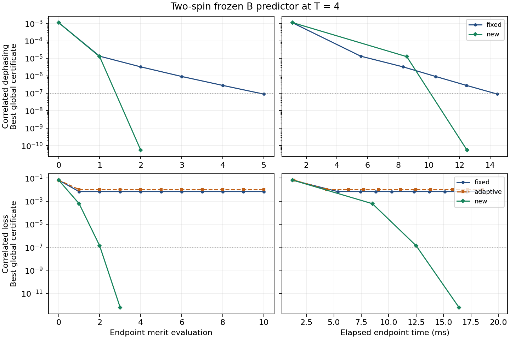

# Frozen noncommuting endpoints

At three spins and $T=4$, the stronger correlated dephasing preparation gave a case in which changing the witness update reduced both the number of corrections and elapsed time. With the same Method B predictor and a global certificate target of $10^{-7}$, the fixed-anchor method needed 19 accepted corrections. Tangent Newton needed one. Across six fresh checkpoint processes the median witness times were 82.9 and 26.3 ms, respectively. The independent root errors were $3.99\times10^{-8}$ and $6.92\times10^{-11}$. These compare the cost of clearing a common threshold. Their final errors differ.

## Matched endpoints

Both channels start from the controlled-phase preparation with polarization 0.35 and angle 0.8. Each small-system trial starts at $t=T-0.25$. Its witness is the **oracle positive fourth root of the independently propagated previous-time density**, represented as an MPO. Independent diagonalization establishes the global errors and spectral ratios. The predictor and Newton solve receive no future root. This experiment isolates the residual effect of the fixed preparation anchor when the incoming witness is already accurate. It measures a single late interval. The successive accepted checkpoint experiments are in the main report.

Method A uses its native two-pass ambient midpoint predictor. Method B uses its two-site Galerkin midpoint with a preparation-based root-velocity preconditioner. Each predictor runs once per frozen case. All its witness variants receive the same tensor objects, with hashes recorded in the measurements. For loss, B uses the correct rate-one lowering generator. Each start stage uses a small-system lower bound obtained from the Hermitian part of the numerical root with a roundoff allowance. The midpoint uses a Weyl displacement bound or a fresh spectral check. Analytically proving the roundoff allowance falls outside this study. Native Method A has its predecessor's retraction and stage conventions.

The original loss audit adapts its legacy fit and correction anchors using the polarization estimate. The **fixed** comparison instead retains both initial witness proposal anchors. All variants share the same positive-map inverse-metric bound at the target time, and the same stored-root test. The new direction uses the current witness. Backtracking, pass limits, and the three factor/root/work levels 4/6/10, 6/8/12 and 8/12/16 are common. All stages record $\|W^4-X_c^2\|_F$ intervals or allocation guards. The timing includes nonlinear trial and linear-residual audits. Each process shared between variants resets the engine's target-time cache to the same previous-time state for each invocation.

## Screening and confirmation

The screen used $N\in\{2,3\}$, $T\in\{1,2,4,8\}$, tolerances $10^{-5}$ and $10^{-7}$, and A, B and carried-root inputs. At strong dephasing, Newton certified 48/48 and legacy fixed certified 44/48. At loss, B hit the predictor iteration limit before the witness at $N=3,T=8$ for both tolerances. Among the remaining 46 comparable cases Newton certified 37, adaptive legacy 6, and fixed legacy 2. Conditioning from the actual $W$ and restriction of the search direction can still prevent an update even with a good initial witness.

The $T=4$, $10^{-7}$ confirmations used six fresh checkpoint processes per family and size. All variants appear equally often in each order position within a predictor. A and B have separate predictor costs. These small local wall times are susceptible to machine load. The following values are medians in milliseconds, with successful times defined only for runs which reached the tolerance. The last two columns show the worst certificate attained over the repeats and the worst scored error of accepted runs.

| Family | Spins | Predictor | Witness | Accepted | Witness ms | Predictor + witness ms | Certificate | Actual CP error |
|---|---:|---|---|---:|---:|---:|---:|---:|
| Strong D | 3 | A | Fixed | 0/6 | – | – | 2.16e-7 | – |
| Strong D | 3 | A | Newton | 6/6 | 28.4 | 40.0 | 2.45e-8 | 1.06e-8 |
| Strong D | 3 | B | Fixed | 6/6 | 82.9 | 99.5 | 9.48e-8 | 3.99e-8 |
| Strong D | 3 | B | Newton | 6/6 | 26.3 | 42.8 | 1.59e-10 | 6.92e-11 |
| Loss | 2 | B | Fixed | 0/6 | – | – | 6.68e-3 | – |
| Loss | 2 | B | Adaptive | 0/6 | – | – | 1.01e-2 | – |
| Loss | 2 | B | Newton | 6/6 | 18.4 | 26.3 | 5.94e-13 | 2.86e-13 |
| Loss | 2 | Carried | Newton | 6/6 | 15.2 | 15.2 | 2.02e-8 | 9.68e-9 |
| Loss | 3 | B | Newton | 0/6 | – | – | 3.62e-7 | – |
| Loss | 3 | A | Newton | 6/6 | 60.7 | 72.1 | 5.53e-8 | 2.32e-8 |

The complete table includes both predictors and correction-only for each pair. Production tracking must additionally pay for representation of the evolving density, accepted checkpoints, and preparation. The frozen-oracle initialization and independent scoring times are recorded separately. These results make no claim about their scalable availability. [Confirmation table](results/frozen_summary/confirmation.csv) · [Screening counts](results/frozen_summary/screen_counts.csv)



## A failed direction separated from an impossible endpoint

At $N=3,T=4$ under loss the generalized eigenvalues comparing the target with the initial density ranged from $5.64\times10^{-6}$ to 4.70. The previous factor's full fourth-power derivative had condition number 45,468. The default Pauli triangle lower bound became inconclusive. After one correction the next MINRES solve returned an original projected residual of $9.51\times10^{-16}$ against an allowance of $5.29\times10^{-17}$. The audit rejected that direction and the full endpoint rolled back. The best partially improved certificate was $3.62\times10^{-7}$.

Replaying identical tensors with a small-system spectral lower bound on **each current factor** enabled unpreconditioned CG. It took two nonlinear corrections to reach a certificate of $1.03\times10^{-11}$ and actual error $4.59\times10^{-12}$. With the same bound, current-factor Jacobi PCG reached its 80-iteration cap. Loosening MINRES's nominal relative tolerance to $10^{-6}$ or $10^{-4}$ alone failed the endpoint audit. The success with a separate current-factor floor means this particular loss failure cannot be attributed solely to bond dimension. Finding positive lower bounds for generic large factors remains open. [Nine tolerance and preconditioner replays](results/frozen_tolerance/measurements.json)

## Reproduction

From the repository root use fresh output paths. The cohort metadata records the Python/SciPy/NumPy versions, source hashes, and deterministic inputs. Its historical `base` field is the checkout HEAD at launch. The upstream Method B base for all cohorts is `23fbd4c89a630688e65d441d9edb6a0056808d21`. Each archived `workers.zip` preserves the worker folders and original paths, including failed solves, partial trials, frozen tensors and logs.

```sh
export OPENBLAS_NUM_THREADS=1 VECLIB_MAXIMUM_THREADS=1 OMP_NUM_THREADS=1 MKL_NUM_THREADS=1
python3 -m tangent_newton_witness.frozen_channels --out run_outputs/frozen-screen --sizes 2 3 --times 1 2 4 8 --tolerances 1e-5 1e-7
python3 -m tangent_newton_witness.frozen_channels --out run_outputs/frozen-confirm --sizes 2 3 --times 4 --tolerances 1e-7 --reps 6
python3 -m tangent_newton_witness.frozen_tolerance --out run_outputs/frozen-tolerance
python3 -m tangent_newton_witness.frozen_summary --screen run_outputs/frozen-screen --confirm run_outputs/frozen-confirm --out run_outputs/frozen-summary
```
