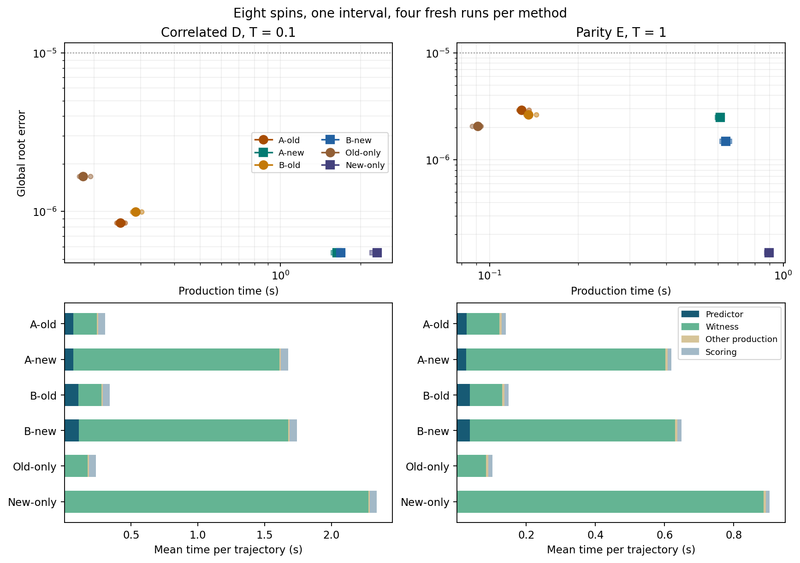
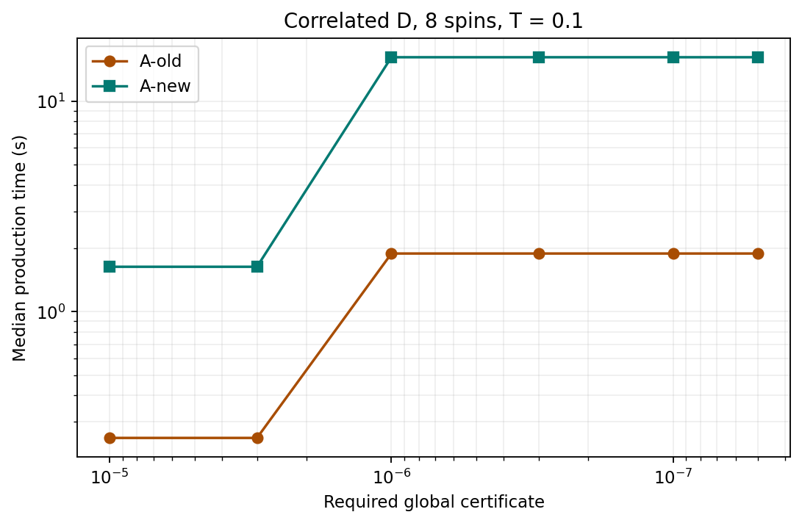
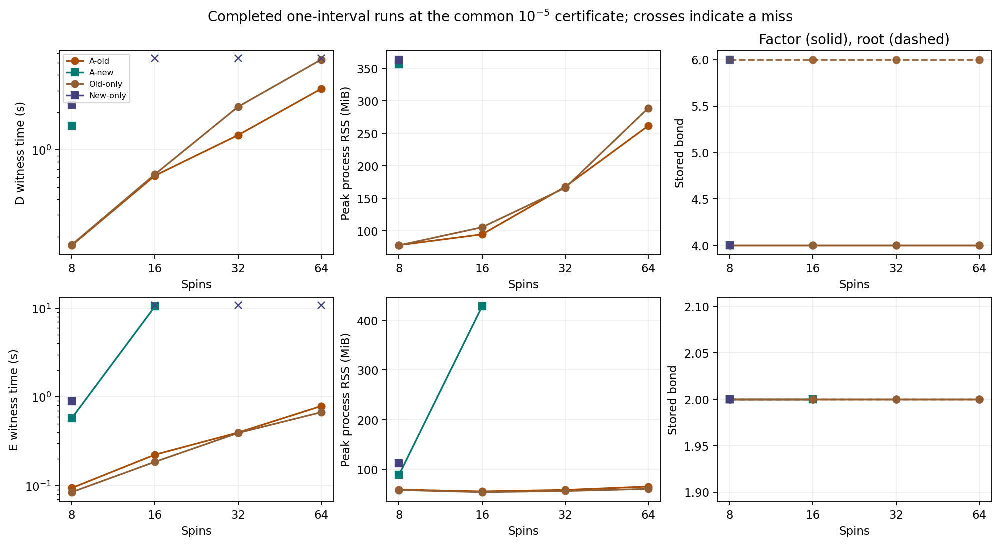
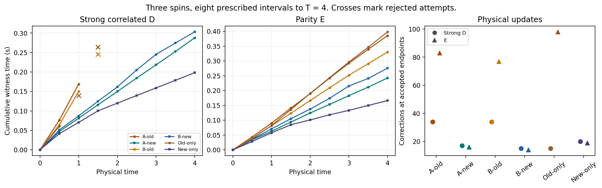
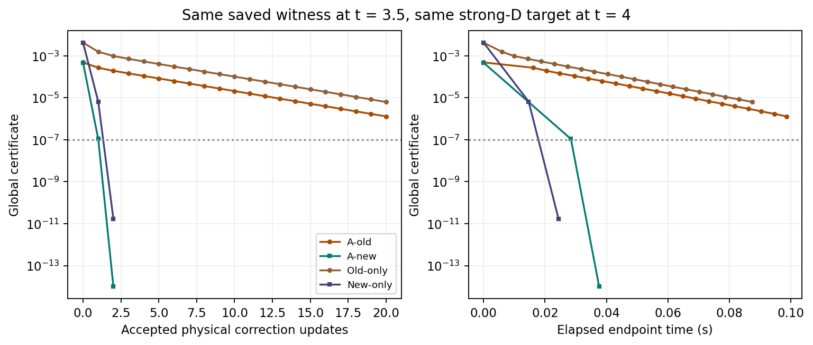

# Tangent Newton correction for a canonical-purification witness

**The current-factor Newton direction helped late-time tracking on small chains with a stale preparation anchor. Its exact MPO contractions made it more expensive on the standard eight-spin benchmarks.** On the stronger three-spin correlated dephasing model, A-new, B-new and Newton correction alone certified eight consecutive endpoints through $T=4$ at $10^{-7}$ in every confirmation. Their fixed-anchor counterparts last certified $t=1$, $1$ and $0.5$. On standard eight-spin D at $T=0.1$ and $10^{-5}$, changing only A’s witness increased median production time from 0.252 to 1.634 s. The corresponding parity comparison at $T=1$ was 0.128 to 0.610 s. The physical density and the global certificate were available to every corrected method.

## Physical objective and algorithms

A canonical purification has amplitude $X=\sqrt{\rho}$ and global error $\lVert X_c-\sqrt{\rho_{\star}}\rVert_F$ in the fixed vectorization convention. Both predictors advance a stored root. A uses its native two-pass approximate ambient Sylvester force and Euclidean projection. B solves the constrained root-velocity equation inside the two-site tangent, retaining its normalization convention and the validated preparation-preconditioned PCG settings. The lower bounds on B's numerical stages come from the earlier stage audits. At restricted rank A and B can yield different predictors. The positive factor $W$ represents the root $X_W=WW^\dagger$. We distinguish its factor distance to a stored root, its implied physical density $X_W^2$, and the externally propagated target $\rho_{\star}$.

| Pipeline | Predictor | Fit and physical correction |
|---|---|---|
| A-old / A-new | Same native A midpoint | Legacy congruences / Hermitian tangent Newton |
| B-old / B-new | Same preconditioned B midpoint | Legacy congruences / Hermitian tangent Newton |
| Old-only / New-only | Carry last accepted state | Legacy physical correction / fourth-power Newton |
| GN | Selected predictor or carry | Real-linear damped LSQR on a general complex factor, up to six spins |

The legacy fitter sandwiches $\widetilde X-WW^\dagger$ between $\rho_{\rm ref}^{-1/8}$ factors and scales by $1/2$. Its physical correction sandwiches the **stored-root** density defect $\rho_{\star}-X_c^2$ between $\rho_{\rm ref}^{-3/8}$ factors and scales by $1/4$. For dephasing the proposal anchor stays at preparation. For loss we compare both the actual adaptive polarization proposal and genuinely fixed initial proposal anchors using the same time-dependent certificate metric. Every method can carry the previously accepted factor.

For a Hermitian $W$, define the unnormalized residual $R_m=T_m-W^m$, with $T_2=\widetilde X$ and $T_4=\rho_{\star}$. Differentiating the products gives

$$
D_2(K)=WK+KW,\qquad
D_4(K)=W^3K+W^2KW+WKW^2+KW^3.
$$

In an orthonormal real Hermitian variation frame $B$ at the **current witness**, solve

$$
(B^\dagger D_m B)v=B^\dagger R_m,\qquad K=Bv.
$$

The code builds fixed powers of the actual represented factor and contracts their action against the frame. $D_4=\mathcal S_{W^2}\mathcal S_W$ holds before projection. A three-site test measures a nonzero difference if a projector is inserted between the two maps. The raw MPO powers use QR gauge reduction without a numerical singular-value cutoff. Trimming the frame is separately budgeted and recorded. Each solve records the recomputed projected residual, ambient residual and outside-tangent component. The optional monitor that compresses $P=WW^\dagger$ to $Q$ charges $\lVert P-Q\rVert_F(2\lVert Q\rVert_F+\lVert P-Q\rVert_F)$ to intervals for $P^2$ and its discrepancy from $X_c^2$. Only the monitor uses this approximation.

Writing each site in the orthonormal Pauli basis turns Hermiticity into real string coefficients. Realification occurs on the represented train, allowing complex virtual gauges. Independent site/pair insertions use left complements, canonical right suffixes and an unrestricted final block. With local dimension $d=4$ the real dimensions are

$$
D_1=\sum_{j=1}^N d\chi_{j-1}\chi_j-\sum_{j=1}^{N-1}\chi_j^2,\qquad
D_2=\sum_{j=1}^{N-1}d^2\chi_{j-1}\chi_{j+1}-\sum_{j=2}^{N-1}d\chi_{j-1}\chi_j .
$$

The second formula holds for $N\ge2$. The single-site boundary uses the free site. Coordinates include the radial direction. Enforcing the normalized-root TDVP constraint here would remove scale forcing from the factor equation. A normalized Hermitian factor would instead require $4\operatorname{Tr}(W^3K)=0$.

In the eigenbasis of $W$, the derivative eigenvalues are $w_a+w_b$ and $(w_a+w_b)(w_a^2+w_b^2)$. For a positive definite witness, projection preserves positivity and the full quartic condition number is $(w_{\max}/w_{\min})^3=(p_{\max}/p_{\min})^{3/4}$ at the positive fourth root. Galerkin minimizes direction error in the derivative energy norm in this case. The projected residual can vanish while an ambient component remains. A positive $WW^\dagger$ gives no lower bound on $W$. CG requires a positive current-factor bound from its Pauli expansion or a supplied, checked small-system estimate. The scaled system retains its original residual check. With inconclusive positivity the Hermitian solver uses MINRES and tests original stationarity, including null forcing. Nonpositive CG curvature rejects a direction.

GN instead minimizes $\lVert J_m(K)-R_m\rVert_F^2+\lambda^2\lVert K\rVert_F^2$. It uses $P=WW^\dagger$, $J_2(K)=KW^\dagger+WK^\dagger$ and $J_4(K)=PJ_2(K)+J_2(K)P$. With $H=(R+R^\dagger)/2$ the real adjoints are $2HW$ and $2(PH+HP)W$. Real and imaginary tangent coefficients are explicit. Physical right-unitary modes $W\Omega$, $\Omega^\dagger=-\Omega$, can remain after removing tensor bond gauge. Damping and a zero start regularize the solve, and original stationarity and attained improvement are rechecked. This optional fallback uses a capped dense residual space and matrix-free LSQR. The production Hermitian method has no dense codomain. [Operator and convergence tests](tests/test_operator.py) · [GN adjoint and null-space tests](tests/test_gn.py)

## Acceptance and support

1. Save $(t,W,X_c,\eta)$ and metric state. Generate the independent target and, if selected, a root predictor.
2. Build the witness frame, solve the square equation and try retracted increments. Keep an update only when its attained distance to the predictor decreases. Keep the better certificate of the fitted predictor and carried root.
3. Rebuild the frame at each accepted factor, solve for the density defect at that factor, and try $\alpha=1,1/2,1/4$. Normalize the **factor** by $\operatorname{Tr}[(W'W'^\dagger)^2]^{-1/4}$. Hermitian-round and normalize the stored root. Measure its actual distance to the rescaled positive product.
4. Require the physical trial to lower the independently certified merit. When a level stalls, try the next declared factor/root/work bond level. Commit only after the agreed tolerance passes. On failure restore the previous tuple and metric. The fixed-grid comparisons record the last admitted grid point. A separate time-bisection driver regenerates the predictor and target from the last accepted time.

For a Hermitian stored root and a full-rank reference the numerical certificate is

$$
2\lVert X_c-WW^\dagger\rVert_F+
\sqrt{\operatorname{Tr}(E^\dagger E M)},\qquad E=X_c^2-\rho_{\star},\quad M\succeq\rho_{\star}^{-1}.
$$

The actual evaluation pays for symmetry repair, residual truncation and applicable reference error. For the circuit families we reused the earlier analytic channel MPO and positive-map metric. D/E dephasing uses the unital inverse bound. The loss audit normalizes the positive map with $\Phi(I)$ and also has a scalar spectral bound. For interacting loss the no-jump contribution implies $\lambda_{\min}(\rho_t)\ge\lambda_{\min}(\rho_0)\exp(-t\lVert \sum_j L_j^\dagger L_j\rVert_2)$. The pure control uses $\tau=I/d_{\rm Hilbert}$ in the gap-free bound, taking the square root of the weighted residual plus the trace-error allowance. Small-chain Taylor propagation charges its analytic tail, Hermitianization and conversion error. A separate matrix exponential supplies the scoring density. Certificates and support thresholds use ordinary double precision. They certify the global error conditional on the model and analytic bounds, with no interval enclosure of floating-point roundoff.

## Standard D and E at matched global accuracy

D uses polarization 0.12, phase angle 0.35 and onsite dephasing. E uses $2^{-N}(I+0.6 Z^{\otimes N}+0.4e^{-t}X_1)$. Preparation, midpoint, target, time grid, witness levels and stopping threshold are shared within a predictor pair. D has direct global scores through eight spins and conditional bounds at larger sizes. E has independent analytic root scores at every size. Exact future roots enter scoring only. The median times below cover **four fresh confirmations** per cell on an Apple M2 with one BLAS thread. A cell lists witness / production seconds. The machine had eight CPU cores and 8 GiB RAM. Some early workers overlapped other experiments on separate cores. The later paired repeats and frozen-source release runs provide additional timing checks. The independent error is the Frobenius distance of the stored canonical root, without gauge alignment. All four workers in every cell cleared the $10^{-5}$ certificate at their requested time.

| Eight-spin pipeline | D witness / production (s) | D global error | E witness / production (s) | E global error |
|---|---:|---:|---:|---:|
| A-old | 0.171 / 0.252 | 8.48e-7 | 0.094 / 0.128 | 2.94e-6 |
| A-new | 1.556 / 1.634 | 5.50e-7 | 0.576 / 0.610 | 2.49e-6 |
| B-old | 0.173 / 0.287 | 9.97e-7 | 0.093 / 0.136 | 2.66e-6 |
| B-new | 1.569 / 1.684 | 5.50e-7 | 0.594 / 0.637 | 1.48e-6 |
| Old-only | 0.173 / 0.182 | 1.67e-6 | 0.084 / 0.091 | 2.06e-6 |
| New-only | 2.301 / 2.311 | 5.50e-7 | 0.888 / 0.894 | 1.35e-7 |

End-to-end times including scoring for A-old/A-new were 0.305/1.687 s on D and 0.140/0.621 s on E. These instrumented endpoints charge audit and event-recording work to both methods. Fresh, unmodified native A/B runs gave 0.149/0.180 s on D and 0.099/0.117 s on E at the same one-interval target, with matching endpoint bounds. The earlier published timings form a separate cohort. Timings here compare the cost of clearing a common certificate threshold. Achieved errors can differ considerably. [All repeated times, errors, bounds and RSS](figures/matched.csv) · [Native reproduction](results/paired_native_smoke/measurements.jsonl)

In the first D8 A pair, both methods accepted three fit updates and one physical correction, ending at factor/root bonds 4/6. Newton took 33 inner iterations across four directions. Its matvecs took 0.061 s, whereas independent **ambient linear-residual audits** took 1.192 s. The final raw fourth-power residual was bracketed by $6.82\times10^{-8}$ and $7.16\times10^{-8}$, and the discrepancy from the square of the compressed root lay between $6.11\times10^{-10}$ and $3.99\times10^{-9}$. The factor normalization changed the raw trace from 1.00000000364 to unity. With the tight target, the first higher-cap A-new confirmation finished at bonds 8/12 after seven physical updates. Its 108 inner iterations used 2.12 s in matvecs and 10.00 s in ambient checks. The maximum product of virtual dimensions presented to a QR panel was 6480. Its retained tensor bond can be much smaller. These nested timings identify the main measured expense. [Loose A-new worker](results/paired_confirm1/r01_001_D8_A-new.zip) · [Tight A-new worker](results/paired_tuned_confirm/r01_001_D8_A-new.zip)

At $10^{-7}$ on D8 the default two-million-entry limit rejected all three new one-interval paths at a best bound near $1.76\times10^{-7}$. The next requested array had 2,359,296 entries. On the two-interval grid they reached $t=0.05$. The old methods reached $T=0.1$. Raising the limit to eight million entries let A-new finish the one-interval screen with actual error $2.03\times10^{-8}$, certificate $4.16\times10^{-8}$, and a process peak around 617 MiB. That screen took about 20 s of witness work. All six standard E8 methods passed both one-interval thresholds. [One-interval grid](results/paired_screen1/measurements.jsonl) · [Two-interval grid](results/paired_screen2/measurements.jsonl) · [Higher-allocation runs](results/paired_tuned_d8/measurements.jsonl)

Four fresh alternating A-old/A-new pairs at the larger cap give the closest comparison in **attained** global accuracy. Old/new median production was **1.889/16.141 s**, witness time **1.808/16.061 s**, and actual error **1.85e-8/2.03e-8**. Certificates were 3.78e-8/4.16e-8. Maximum process RSS was 308/697 MiB. The old method was 8.5 times faster at comparable measured error. The two-worker higher-cap screen cost 42.2 worker-seconds including launches, separate from 75.2 worker-seconds for the eight confirmations. For the standard one-/two-interval N8 grids the screens cost another 47.0/60.7 worker-seconds. These sums count all enrolled trials including failures. [Matched tight repetitions](results/paired_tuned_confirm/measurements.jsonl) · [Observed qualifying configurations](figures/frontier.csv)

At 16, 32 and 64 spins every old method passed the $10^{-5}$ one-interval screen on both families. Of the 18 corresponding new workers, only E16 A-new and B-new completed within the 12 s and 768 MiB worker limits. Their production times were 10.56 and 10.52 s, against 0.301 and 0.294 s for the old pair. The D16 new endpoints rejected or exhausted their width budget. E32 New-only exceeded the sampled process-memory limit. A timeout records a cost ceiling and the last known endpoint. At the tight one-interval correction-only threshold the old parity method also passed at 16, 32 and 64 spins, while the bounded Newton workers timed out or exceeded RSS. On D16, Old-only passed and New-only rejected. Both methods exceeded their resources on D32 and D64 at that tight target. Dstress8 also yielded no accepted first quarter-time checkpoint in the strict late screen. A timeout leaves eventual convergence unresolved. Fixed input bond alone controls neither Krylov iterations nor conditioning. In the absence of truncation the bonds for $W^2,W^3,W^4$ can reach $\chi_W^2,\chi_W^3,\chi_W^4$ before geometric reduction. Products with a two-site tangent and the ambient residual checks can dominate even when the stored root is small. [Per-worker outcomes and limits](results/paired_scale/measurements.jsonl) · [Tight correction-only screen](results/paired_scale_tight/measurements.jsonl) · [Strong-D8 outcomes](results/paired_lateD8/measurements.jsonl)

## Repeated late-time tracking and the role of the anchor

The stronger preparation has polarization 0.35 and angle 0.8. At $N=3$, $h=0.5$ and $T=4$, the threshold was $10^{-7}$ **at each of eight successive endpoints**. All four confirmations agreed on which methods reached the horizon. This table uses the same four-repeat cohort throughout. Entries for a rejection give the last accepted physical time.

| Pipeline | Strong D production (s) | Final global error | E production (s) | Final global error |
|---|---:|---:|---:|---:|
| A-old | reached 1.0 | — | 0.495 | 2.25e-8 |
| A-new | 0.420 | 3.68e-15 | 0.346 | 4.78e-15 |
| B-old | reached 1.0 | — | 0.492 | 2.18e-8 |
| B-new | 0.460 | 6.57e-9 | 0.334 | 6.38e-9 |
| Old-only | reached 0.5 | — | 0.416 | 2.14e-8 |
| New-only | 0.235 | 7.48e-12 | 0.183 | 9.43e-12 |

A separate four-repeat cohort ran after the overlapping large-chain screens. E3 production medians were A-old/new **0.426/0.299 s**, B-old/new **0.405/0.286 s**, and Old-only/New-only **0.350/0.150 s**. The corresponding physical correction counts fell from 83 to 16, 77 to 14, and 98 to 19. Strong-D3 New-only took 0.208 s there. These are wall times on a shared desktop. Timings include full residual audits and event writes. [Additional serial confirmations](results/paired_late_serial/measurements.jsonl)

On E3 A's witness cost fell from 0.394 to 0.245 s and B's from 0.384 to 0.233 s. On strong D3 Newton-only took 0.217 s in the witness. Doubling the horizon to $T=8$ while retaining $h=0.5$ produced 16 accepted intervals for all three new methods on both families in the screen. At fixed $T=4$, four and sixteen intervals also completed with the new updates. E8 at the same late horizon reversed the E3 cost ranking. All six methods finished eight steps in the E8 screen, with A-old/A-new taking 1.67/5.70 s. A small-chain advantage did not extend to this larger representation. [Repeated trajectories](results/paired_late_confirm/measurements.jsonl) · [Longer horizon](results/paired_horizon/measurements.jsonl) · [Step refinement](results/paired_step_refine/measurements.jsonl) · [Eight-spin comparison](results/paired_late8/measurements.jsonl)

In a frozen replay from the **computed, certified** strong-D3 $t=3.5$ checkpoint, the incoming root's error to the new target was 0.001900 and A's raw prediction reduced it to 0.000208. The eigenvalue range of the target relative to the initial density was $[0.544,2.197]$. Hashes identify identical inputs within each comparison. Legacy fit plus Newton physical correction reached a $7.51\times10^{-15}$ bound. Newton fit plus legacy physical correction, both fit-only variants, and the fixed-anchor correction alone all missed $10^{-7}$ under the common budgets. New-only reached a $1.72\times10^{-11}$ bound. This isolates the fourth-power direction at this checkpoint. An independently frozen **oracle** experiment, initialized with the exact previous factor, also has a matched success on both sides. With B on strong D3 at $T=4$, old/new took 19/1 corrections and 82.9/26.3 ms median witness time across six repeats. [Computed checkpoint replay](results/paired_frozen_replay/measurements.jsonl) · [Exact-previous-factor comparisons](frozen_report.md)

The commuting population-drift control starts from $[(I+0.86X)/2]^{\otimes N}$ and damps the transverse coefficient by $e^{-t}$. For a scalar $p$ without retraction, differentiating the legacy update near the solution gives $e_{k+1}\simeq[1-\alpha(p/p_{\rm ref})^{3/4}]e_k$. Large ratios can overshoot even after backtracking. Small ratios can leave slowly decaying error. At $N=4$, $t=3.5\to4$, the generalized eigenvalues ranged from 0.08894 to 2442.91. All methods started from the same exact previous factor in this control. The initial-anchor method stalled at bound 0.3013. Recentring only its proposal anchor at the previous density gave $2.18\times10^{-6}$, Newton gave $1.07\times10^{-7}$, and GN gave $1.07\times10^{-7}$ against the same $10^{-5}$ target. Separate multi-step runs from $t=0$ reached $T=4$ with New-only for $N=1,2,4$. At $N=2$, B-new and New-only also completed 16 steps to $T=8$. A-new selected a poor fitted starting branch and failed the first certificate. With four allowed halvings, Old-only made certified partial progress to $0.1875$ out of $0.5$, while New-only passed the full interval. The scalar linearization explains sensitivity to populations in this control. The correlated and loss experiments test distinct, noncommuting cases. [Product and loss trajectories](results/stress_late_final/) · [Anchor controls](results/stress_frozen_final/) · [Adaptive histories](results/controls_final/)

Under correlated amplitude damping, the two-spin New-only trajectory met $10^{-5}$ at eight checkpoints to $T=4$, with final measured error $1.55\times10^{-6}$. Fixed Old-only last certified $t=0.5$ and the adaptive-polarization variant rejected the first half-unit interval. In the frozen two- and three-spin loss screen, the shared B predictor failed before the endpoint for two $N=3,T=8$ cases. Among the remaining 46 comparable cases, Newton met the target 37 times, fixed legacy twice and adaptive legacy six times. At three spins and $T=4$ one Newton solve missed the original stationarity tolerance. An independently checked lower bound on the actual factor admitted CG and recovered a $1.03\times10^{-11}$ certificate. Loosening MINRES alone failed. [Frozen loss measurements and failure replays](frozen_report.md)

Long time by itself did not defeat the old anchor. On **standard D** at three spins, all six methods certified 16 consecutive half-unit steps through $T=8$ at $10^{-7}$. Old-only and New-only each took about 0.27 s in this single screen, with actual errors $1.83\times10^{-8}$ and $2.31\times10^{-11}$. On standard D8 with four intervals to $T=1$, all six passed $10^{-5}$. A-old/A-new took 1.62/7.02 s and B-old/B-new took 1.83/7.16 s. The strong-preparation result therefore depends on the path and accuracy target as well as the horizon. [Standard D3 long trajectory](results/standard_d_long3/measurements.jsonl) · [Standard D8 trajectory](results/standard_d_long8/measurements.jsonl)

An additional 96 workers reran the standard eight-spin endpoints and the three-spin late trajectories directly from committed solver source `e00ed2d4072498e513e1840c6bc8b97df9aade11`. All 48 short runs completed. On the late grid all 36 expected successes and 12 expected rejections recurred, with identical last accepted times. The release D8 comparison gave 0.254/1.607 s for A-old/new. On late strong D3 all four New-only workers reached $T=4$ with median production 0.216 s. On late E3 Old-only/New-only took 0.349/0.154 s. No worker changed its numerical source during these runs. [Release summaries](results/validation_01/release_summary.json)

## Conditioning, rank opening and direct-factor controls

The 112 frozen linear-direction trials separately measured the spectrum of the projected derivative. On four-spin product drift, the full fourth-power condition number **decreased** from 2345 to 1.10 by $t=4$, while mismatch with preparation grew. On two-spin loss it **increased** from 2.99 to 1951. For the initial product factor the one-/two-site projected condition numbers were 15.7/81.9. Current-factor Jacobi took longer in all 14 checkpoint/mode medians despite sometimes lowering the spectral condition number. Iteration counts also depend on the forcing's spectral weights. A full-space noncommuting test gave square-solve factor errors $0.105,0.00454,1.25\times10^{-5},1.06\times10^{-10}$, and fourth-power errors $0.105,0.0135,3.25\times10^{-4},2.23\times10^{-7}$. The data support local quadratic convergence there. Restricted tangents, line search, normalization and rounding change the iteration. The one-site and two-site late three-spin screens reached similar errors. A separate restricted-rank test directly demonstrates a pair direction opening a bond. [Spectra, Krylov costs, tolerances and local convergence](conditioning.md) · [One-site screen](results/paired_ablate_one/measurements.jsonl)

The generic interacting control uses Ising coupling 0.7, fields 0.43/0.19 and site-dependent lowering. For the full-rank two-spin input with a 0.001 maximally mixed fraction, Newton and GN reached $T=0.03$ in three certified steps. Their final errors were $5.59\times10^{-7}$ and $5.73\times10^{-7}$. For a pure input, a partial-time positive bridge followed by a jump to the requested endpoint failed the gap-free certificate. Taking the established four-substep finite Kraus seed over the **whole first interval** resolved the newborn sectors. Both variants then reached $T=0.01$, with measured errors about $7.3\times10^{-11}$ and gap-free bounds about $6.2\times10^{-7}$. The bridge is common initialization work. Its root is computed from the physical channel and the incoming state. These pure and interacting controls use a dense small-system support audit and target propagator.

At zero population the first derivative can vanish in a newborn sector, even with a nonzero physical source. A population of order $h$ needs a root of order $\sqrt h$ and positive-gauge factor of order $h^{1/4}$. The tests distinguish first and Hamiltonian-delayed opening, a compatible dark sector and small positive eigenvalues. The bridge rechecks support after factor rounding. Large generic mixed-MPO continuation without a detector, a reliable physical reference and an admissible metric remains unsupported. [Support tests](tests/test_support.py) · [Short interacting controls](results/stress_short_final/) · [Full-interval bridge controls](results/controls_final/)

The uninterrupted raw predictors further separate integration from endpoint correction. At strong D3 $T=4$, raw A/B global errors were 0.00374/0.00216 over eight intervals. At standard D8 they were $1.20\times10^{-5}/1.12\times10^{-5}$ over two intervals. At E8 they were 0.00999/0.00692. These small-system controls use explicit stored-stage spectral checks for B. The contextual factor-TDVP engines integrate a continuous density-residual objective. On D3 their explicit SVD and MPO LSQR yielded the same $6.10\times10^{-6}$ root error in two steps, taking 0.683 and 0.226 s including scoring. On the longer $T=1$ E3 two-step path both had error 0.00830. They did not enter the matched-certificate rankings. [Raw predictor histories](results/controls_final/) · [Fresh factor-TDVP runs](results/context_02/)

## Interpretation

1. **Coverage.** The strongest evidence for robustness comes from the repeated three-spin strong-D evolution, the frozen same-predictor replay and the loss screen. There are clear counterexamples to universal convergence, including A-new on product drift and the default tight D8 run.
2. **Cost at a common target.** On standard D8 and E8 the original update remained cheaper both inside the witness and for the complete trajectory. On late E3 Newton cut both costs, and at a common late strong-D3 checkpoint it cleared the same certificate in about a third of the witness time with B. Large-chain products made even inexpensive warm starts costly.
3. **Conditioning and coordinates.** Anchor drift and the conditioning of the current derivative can move in opposite directions. Two-site coordinates can open spatial bonds, but alone do not guarantee small ambient residuals. Current Jacobi added setup/application cost on the measured checkpoints.
4. **Attribution.** Frozen fit/correction swaps isolate the fourth-power direction in the strongest late replay. A recentered legacy proposal also succeeds on the commuting oracle. Tight D8 recovered by relaxing an allocation cap. The acceptance target and physical normalization stayed fixed in those comparisons.
5. **Predictor economics.** B-new is viable on hard small paths, including a population-drift case where A-new failed. When the physical density is already available, correction-only was the cheapest qualifying member of the strong-D3 and E3 late repeats. This study establishes no general production-time advantage of B over A.
6. **Remaining assumptions.** Only the new update direction dispenses with reference inverse powers. Initialization still uses a prepared factor. The predictors retain their native preparation operators and stage audits, and the instrumented D/E engine constructs legacy data even on new-only runs. Certification still needs an independently propagated density, its error budget and a valid metric or gap-free weight. Replacing untruncated high-bond products and controlling support in generic large systems remain the limiting development questions.
